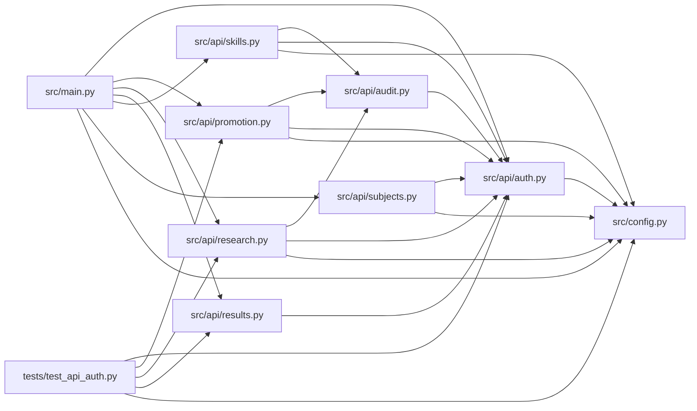

# auth Module

**Path:** `src/api/auth.py`

## Description

Authentication dependencies for the autoresearch API.

## Imports

| Source | Symbols |
|--------|---------|
| `__future__` | `annotations` |
| `base64` | `base64` |
| `binascii` | `binascii` |
| `collections.abc` | `Awaitable`, `Callable` |
| `dataclasses` | `dataclass` |
| `fastapi` | `Depends`, `HTTPException`, `Request`, `WebSocket`, `status` |
| `fastapi.responses` | `JSONResponse` |
| `fastapi.security` | `HTTPAuthorizationCredentials`, `HTTPBearer` |
| `hashlib` | `hashlib` |
| `httpx` | `AsyncClient` |
| `logging` | `logging` |
| `secrets` | `secrets` |
| `src.config` | `secret_value`, `settings` |
| `typing` | `Any` |

## Local dependency map

<!-- Auto-generated local dependency summary. Do not edit by hand. -->

### Internal neighbors

| Direction | Module |
|---|---|
| Inbound | [audit](../modules/audit.md) |
| Inbound | [promotion](../modules/promotion.md) |
| Inbound | [research](../modules/research.md) |
| Inbound | [results](../modules/results.md) |
| Inbound | [src_api_skills](../modules/src_api_skills.md) |
| Inbound | [subjects](../modules/subjects.md) |
| Inbound | [src_main](../modules/src_main.md) |
| Inbound | [test_api_auth](../modules/test_api_auth.md) |
| Outbound | [config](../modules/config.md) |

### External packages

| Language | Used packages | Undeclared packages |
|---|---:|---:|
| python | 2 | 1 |

## Classes

| Class | Line | Bases | Description |
|-------|------|-------|-------------|
| [AuthenticatedActor](../entities/AuthenticatedActor.md) | 53 | — | Authenticated caller context used for audit metadata. |

## Functions

| Function | Signature | Decorators | Description |
|----------|-----------|------------|-------------|
| `introspect_token` | *(async)* `(endpoint_url: str, token: str, timeout_s: float) -> dict[str, Any]` | — | Introspect a bearer token via OAuth2 Token Introspection (RFC 7666). |
| `_configured_token` | `() -> str \| None` | — | — |
| `_auth_required` | `() -> HTTPException` | — | — |
| `_auth_not_configured` | `() -> HTTPException` | — | — |
| `_admin_required` | `() -> HTTPException` | — | — |
| `token_fingerprint` | `(token: str \| None) -> str \| None` | — | Return a non-reversible token fingerprint safe for audit storage. |
| `_roles_from_identity_payload` | `(payload: dict[str, Any]) -> tuple[str, ...]` | — | — |
| `_identity_is_admin` | `(payload: dict[str, Any]) -> bool` | — | — |
| `_identity_subject` | `(payload: dict[str, Any]) -> str` | — | — |
| `_authenticate_identity_token` | *(async)* `(token: str, *, mechanism: str, websocket_subprotocol: str \| None = None) -> AuthenticatedActor` | — | — |
| `_authenticate_token` | *(async)* `(token: str \| None, *, mechanism: str, websocket_subprotocol: str \| None = None) -> AuthenticatedActor` | — | — |
| `require_api_auth` | *(async)* `(request: Request, credentials: HTTPAuthorizationCredentials \| None = _bearer_dependency) -> AuthenticatedActor` | — | Require ``Authorization: Bearer <token>`` for HTTP API routes. |
| `_audit_store_from_connection` | `(connection: Request \| WebSocket) -> Any` | — | — |
| `_connection_metadata` | `(connection: Request \| WebSocket, *, mechanism: str, status_code: int) -> dict[str, object]` | — | — |
| `_record_auth_rejection` | *(async)* `(connection: Request \| WebSocket, *, token: str \| None, mechanism: str, exc: HTTPException) -> None` | — | — |
| `_parse_authorization_header` | `(value: str \| None) -> str \| None` | — | — |
| `_decode_subprotocol_token` | `(protocol: str) -> str \| None` | — | — |
| `_parse_websocket_subprotocol_token` | `(value: str \| None) -> tuple[str \| None, str \| None]` | — | — |
| `require_websocket_auth` | *(async)* `(websocket: WebSocket) -> AuthenticatedActor \| None` | — | Authenticate a WebSocket before accepting the connection. |
