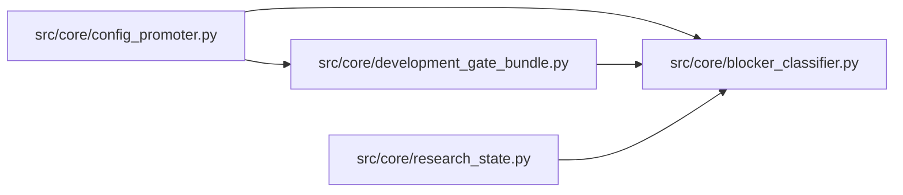

# blocker_classifier Module

**Path:** `src/core/blocker_classifier.py`

## Description

Structured promotion blocker classification for operator-facing previews.

## Imports

| Source | Symbols |
|--------|---------|
| `__future__` | `annotations` |
| `typing` | `Any`, `Dict`, `Iterable`, `Mapping`, `Optional` |

## Local dependency map

<!-- Auto-generated local dependency summary. Do not edit by hand. -->

### Internal neighbors

| Direction | Module |
|---|---|
| Inbound | [config_promoter](../modules/config_promoter.md) |
| Inbound | [development_gate_bundle](../modules/development_gate_bundle.md) |
| Inbound | [research_state](../modules/research_state.md) |

## Functions

| Function | Signature | Decorators | Description |
|----------|-----------|------------|-------------|
| `classify_blockers` | `(blockers: Iterable[Any], *, checks: Optional[Iterable[Mapping[str, Any]]] = None, metrics_payload: Optional[Mapping[str, Any]] = None, phase_state: Optional[Mapping[str, Any]] = None, source: str = 'promotion_preview') -> list[dict[str, Any]]` | — | Return stable structured details for promotion blocker codes. |
| `blocker_details` | `(blockers: Iterable[Any], *, checks: Optional[Iterable[Mapping[str, Any]]] = None, metrics_payload: Optional[Mapping[str, Any]] = None, phase_state: Optional[Mapping[str, Any]] = None, source: str = 'promotion_preview') -> list[dict[str, Any]]` | — | Compatibility wrapper for call sites that only need details. |
| `_category_for` | `(code: str, *, metrics_payload: Mapping[str, Any], phase_state: Mapping[str, Any]) -> str` | — | — |
| `_missing_nested_result_payload` | `(code: str, metrics_payload: Mapping[str, Any]) -> bool` | — | — |
| `_has_result_artifact_reference` | `(metrics_payload: Mapping[str, Any]) -> bool` | — | — |
| `_phase_not_completed` | `(phase_state: Mapping[str, Any], phase_id: str) -> bool` | — | — |
| `_check_names_by_blocker` | `(checks: Iterable[Mapping[str, Any]]) -> dict[str, str]` | — | — |
| `_is_tsfm_candidate` | `(metrics_payload: Mapping[str, Any]) -> bool` | — | — |
| `_first_mapping` | `(*values: Any) -> dict[str, Any]` | — | — |
| `_mapping_at` | `(root: Mapping[str, Any], key: str) -> dict[str, Any]` | — | — |
| `_humanize_code` | `(value: str) -> str` | — | — |
