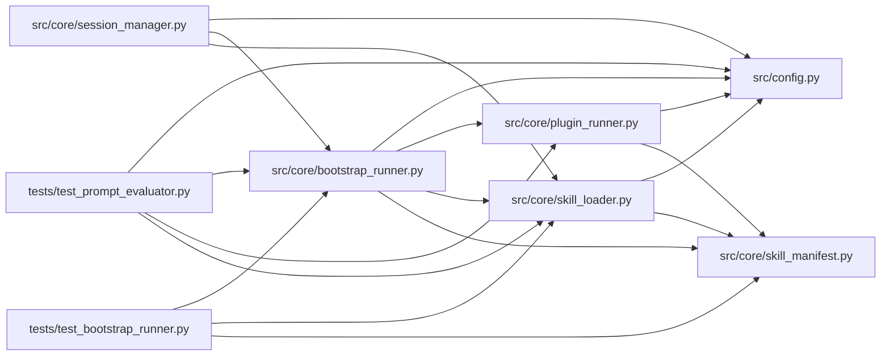

# bootstrap_runner Module

**Path:** `src/core/bootstrap_runner.py`

## Description

Bootstrap runner — execute a skill's ``bootstrap.py`` at session start
(ARC-011 P5-005 / P5-006 / P5-008).

The ``BootstrapRunner`` is the first consumer of ``PluginRunner``
(``plugin_runner.py``). It runs a skill's ``bootstrap.py`` once per session to
render the workspace (scaffold/, knowledge/ corpus, eval smoke-check, system
prompt assembly) and writes a ``session_bootstrap.v1`` artifact recording what
was rendered. This is step 2 of the ARC-011 §5.4 auto-initialization lifecycle.

What moves here in Phase 5 (P5-007): the workspace-prep logic that today lives
in ``session_manager`` (``_archive_stale_workspace``, train.yaml/best_train.yaml
rendering, ``{runs_dir}/{instrument}_{timeframe}/{model_type}`` derivation) and
the 61 ``prepare.py``/``train.yaml`` references in ``orchestrator.py`` migrate
into each skill's ``bootstrap.py``. The orchestrator becomes purely loop +
guards; it reads the rendered workspace from this artifact.

Design decisions (P1-007 house style):

* **Thin orchestrator over PluginRunner.** ``BootstrapRunner`` does not spawn
  subprocesses itself — it delegates to ``PluginRunner`` so all skill-supplied
  Python execution funnels through one governed path (X-004 D2).
* **The artifact is the contract.** ``session_bootstrap.v1`` is what the
  orchestrator reads to learn the rendered workspace layout, what P5-008's dry
  mode diffs against, and what P5-024/P5-026 reviewers inspect before promoting
  a draft. Its shape is stable and forward-compat (additive only).
* **Idempotent.** Re-bootstrapping a session whose artifact already matches the
  rendered file hashes is a no-op (P5-009). The caller decides when to invoke.
* **Dry mode (P5-008).** ``run(dry=True)`` executes the bootstrap in a
  throwaway overlay of a fresh workspace, then captures the planned writes
  without committing them to the real session workspace. Required for
  ``draft``/generated skills (X-004 D5); optional for vetted ``stable`` skills.

## Imports

| Source | Symbols |
|--------|---------|
| `__future__` | `annotations` |
| `dataclasses` | `dataclass` |
| `datetime` | `datetime`, `timezone` |
| `hashlib` | `hashlib` |
| `json` | `json` |
| `logging` | `logging` |
| `os` | `_os` |
| `pathlib` | `Path` |
| `shutil` | `shutil` |
| `src.config` | `settings` |
| `src.core.plugin_runner` | `PluginResult`, `PluginRunner` |
| `src.core.skill_loader` | `SkillLayout` |
| `src.core.skill_manifest` | `PluginCaps`, `ResearchSkillManifest` |
| `tempfile` | `tempfile` |
| `typing` | `Any`, `Optional` |

## Local dependency map

<!-- Auto-generated local dependency summary. Do not edit by hand. -->

### Internal neighbors

| Direction | Module |
|---|---|
| Inbound | [session_manager](../modules/session_manager.md) |
| Inbound | [test_bootstrap_runner](../modules/test_bootstrap_runner.md) |
| Inbound | [test_prompt_evaluator](../modules/test_prompt_evaluator.md) |
| Outbound | [config](../modules/config.md) |
| Outbound | [plugin_runner](../modules/plugin_runner.md) |
| Outbound | [skill_loader](../modules/skill_loader.md) |
| Outbound | [skill_manifest](../modules/skill_manifest.md) |

## Classes

| Class | Line | Bases | Description |
|-------|------|-------|-------------|
| [BootstrapOutcome](../entities/BootstrapOutcome.md) | 74 | — | Result of a bootstrap run, including the resolved artifact. |
| [SessionBootstrapArtifact](../entities/SessionBootstrapArtifact.md) | 89 | — | The ``session_bootstrap.v1`` artifact (P5-006). |
| [BootstrapRunner](../entities/BootstrapRunner.md) | 228 | — | Run a skill's ``bootstrap.py`` once at session start (P5-005). |

## Functions

| Function | Signature | Decorators | Description |
|----------|-----------|------------|-------------|
| `_server_demo_mode` | `() -> bool` | — | — |
| `_hash_file` | `(path: Path, *, relative_to: Path) -> Optional[dict[str, Any]]` | — | Return ``{path, sha256, size_bytes}`` for one rendered file, or None. |
| `_index_rendered` | `(workspace: Path) -> list[dict[str, Any]]` | — | Walk the workspace and record every rendered file's hash + size. |
| `_hash_str` | `(text: str) -> str` | — | — |
