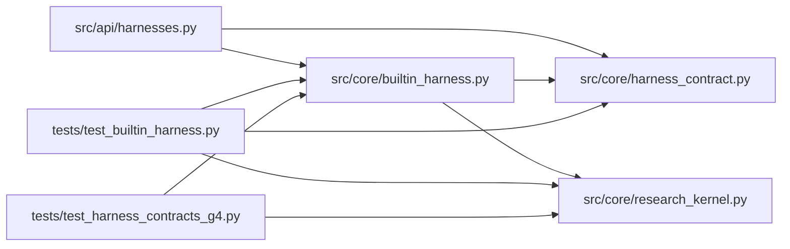

# builtin_harness Module

**Path:** `src/core/builtin_harness.py`

## Description

The built-in provider/tool loop as a harness adapter.

``BuiltinHarnessAdapter`` wraps the corrected built-in loop behind the
harness contract: it is selectable by name through the registry, executes
attempts through the existing tool/output-parser machinery, and routes its
proposals through the research kernel. Its workspace instruction
convention (``CLAUDE.md``) is harness-owned data — core behavior never
depends on the filename or on any provider's tool-block shape.

## Imports

| Source | Symbols |
|--------|---------|
| `__future__` | `annotations` |
| `src.core.harness_contract` | `ATTACH_MODE_CONTINUATION`, `ATTACH_MODE_NATIVE_RESUME`, `CAPABILITY_PAUSE`, `CAPABILITY_RESUME`, `HARNESS_CONTRACT_VERSION`, `HarnessContractError`, `HarnessIdentity`, `HarnessLifecycleError`, `HarnessProposal` |
| `src.core.research_kernel` | `AttemptPlan`, `AttemptResult`, `ObjectiveDecision`, `decide_objective` |
| `typing` | `Any`, `Callable`, `Iterator`, `Mapping`, `Optional` |

## Local dependency map

<!-- Auto-generated local dependency summary. Do not edit by hand. -->

### Internal neighbors

| Direction | Module |
|---|---|
| Inbound | [harnesses](../modules/harnesses.md) |
| Inbound | [test_builtin_harness](../modules/test_builtin_harness.md) |
| Inbound | [test_harness_contracts_g4](../modules/test_harness_contracts_g4.md) |
| Outbound | [harness_contract](../modules/harness_contract.md) |
| Outbound | [research_kernel](../modules/research_kernel.md) |

## Classes

| Class | Kind | Line | Bases / Target | Description |
|-------|------|------|----------------|-------------|
| [AttemptFn](../entities/AttemptFn.md) | Type alias | 35 | `Callable[[Mapping[str, Any], int], Mapping[str, Any]]` | — |
| [BuiltinHarnessAdapter](../entities/BuiltinHarnessAdapter.md) | Class | 38 | — | The built-in loop behind the harness contract and kernel driver. |
