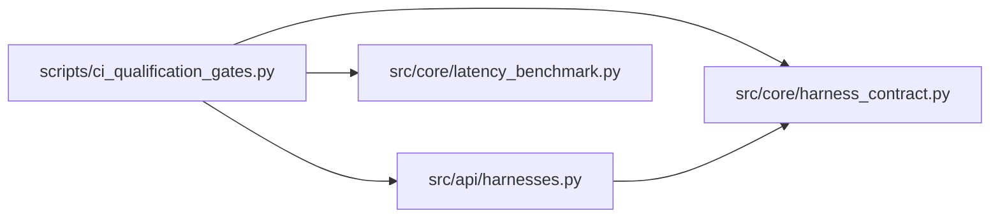

# ci_qualification_gates Module

**Path:** `scripts/ci_qualification_gates.py`

## Description

Named qualification gates for CI — enforceable compatibility claims.

Deterministic gates cover trust, domain semantics, migrations,
cross-store behavior, adapters, API/CLI/UI, and deployment artifacts.
Missing required coverage fails the run; every skip must carry an
explicit owner; qualification inputs and adapter versions are pinned;
live external checks are opt-in, budget-bounded, and reported in a lane
visibly separate from mocks; archived evidence is scanned for secrets.

Usage:
    python scripts/ci_qualification_gates.py [--gate NAME] [--live]
        [--report-dir PATH] [--dry-run]

## Imports

| Source | Symbols |
|--------|---------|
| `__future__` | `annotations` |
| `argparse` | `argparse` |
| `dataclasses` | `asdict`, `dataclass`, `field` |
| `fnmatch` | `fnmatch` |
| `hashlib` | `hashlib` |
| `json` | `json` |
| `os` | `os` |
| `pathlib` | `Path` |
| `re` | `re` |
| `src.api.harnesses` | `build_default_registry`, `_descriptor`, `build_default_registry` |
| `src.core.harness_contract` | `OPTIONAL_CAPABILITIES` |
| `src.core.latency_benchmark` | `build_workload` |
| `subprocess` | `subprocess` |
| `sys` | `sys` |
| `time` | `time` |
| `typing` | `Any`, `Callable`, `Mapping`, `Optional`, `Sequence` |

## Local dependency map

<!-- Auto-generated local dependency summary. Do not edit by hand. -->

### Internal neighbors

| Direction | Module |
|---|---|
| Outbound | [harnesses](../modules/harnesses.md) |
| Outbound | [harness_contract](../modules/harness_contract.md) |
| Outbound | [latency_benchmark](../modules/latency_benchmark.md) |

## Classes

| Class | Line | Bases | Description |
|-------|------|-------|-------------|
| [SkipOwner](../entities/SkipOwner.md) | 41 | — | — |
| [Gate](../entities/Gate.md) | 95 | — | — |
| [GateResult](../entities/GateResult.md) | 336 | — | — |

## Functions

| Function | Signature | Decorators | Description |
|----------|-----------|------------|-------------|
| `check_required_coverage` | `(passed_ids: Sequence[str], required: Sequence[str]) -> list[str]` | — | An advertised feature without executable coverage fails. |
| `check_skip_ownership` | `(skipped_ids: Sequence[str], owners: Sequence[SkipOwner]) -> list[str]` | — | A skip without a declared owner fails the run. |
| `check_pinned_inputs` | `(pinned: Mapping[str, Any], current: Mapping[str, Any]) -> list[str]` | — | Qualification inputs and adapter versions must match the pin. |
| `check_unsupported_report` | `(descriptors: Sequence[Mapping[str, Any]], optional_capabilities: Sequence[str]) -> list[str]` | — | Every unadvertised optional capability must carry a reason. |
| `scan_for_secrets` | `(text: str, secret_values: Sequence[str] = ()) -> list[str]` | — | Archived evidence must contain no secrets. |
| `redact` | `(text: str, secret_values: Sequence[str] = ()) -> str` | — | — |
| `_file_digest` | `(path: Path) -> str` | — | — |
| `collect_current_inputs` | `() -> dict[str, Any]` | — | Live identity of every qualification input the gates depend on. |
| `parse_pytest_output` | `(output: str) -> tuple[list[str], list[str], list[str]]` | — | — |
| `run_pytest` | `(suites: Sequence[str], timeout_s: int) -> tuple[int, str]` | — | — |
| `evaluate_gate` | `(gate: Gate, *, run: Callable[[Sequence[str], int], tuple[int, str]], owners: Sequence[SkipOwner] = SKIP_OWNERS, live_opt_in: bool = False, missing_env: Sequence[str] = ()) -> GateResult` | — | One gate: coverage, ownership, and honest live separation. |
| `collect_capability_report` | `() -> tuple[list[dict[str, Any]], list[str]]` | — | The unsupported-capability report the gates enforce. |
| `write_evidence` | `(report_dir: Path, payload: Mapping[str, Any], secret_values: Sequence[str] = ()) -> list[str]` | — | Archive sanitized evidence; return sanitization findings. |
| `main` | `(argv: Optional[Sequence[str]] = None) -> int` | — | — |
