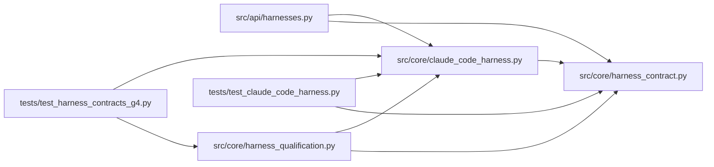

# claude_code_harness Module

**Path:** `src/core/claude_code_harness.py`

## Description

Claude Code harness adapter: the second independent external harness.

Interface selection (rechecked against the current official Claude Code
programmatic documentation at implementation time): the ``claude -p``
non-interactive CLI with ``--output-format stream-json`` — the Agent SDK
CLI's structured event stream. Human-oriented terminal prose is never
parsed; only the structured events are.

Pinned shape (``claude-code-stream-json.system-init.v2``): ``system/init``
carries the session identifier and tool/permission configuration,
``assistant`` events carry content blocks (text, tool_use) and Anthropic
usage, and ``result`` carries usage, total cost, permission denials, and
the session identifier. Authentication and hosting: the harness's own
Anthropic credential (``ANTHROPIC_API_KEY`` or an interactive login) runs
in a per-run ``CLAUDE_CONFIG_DIR`` so session state is adapter-owned and
isolated per hosted run — never the platform's operator credentials.

Qualified resume: native session resume IS a documented supported feature
(``--resume <session_id>`` within the same config directory), so it is
advertised with that exact qualification; pause and steering are not
demonstrated and are refused explicitly. Cancellation is process-group
supervision. The harness's own tools are ordinary tool access: never
evaluator execution and never promotion authority.

## Imports

| Source | Symbols |
|--------|---------|
| `__future__` | `annotations` |
| `dataclasses` | `dataclass`, `field` |
| `json` | `json` |
| `os` | `os` |
| `shutil` | `shutil` |
| `signal` | `signal` |
| `src.core.harness_contract` | `ATTACH_MODE_CONTINUATION`, `ATTACH_MODE_NATIVE_RESUME`, `CAPABILITY_RESUME`, `HARNESS_CONTRACT_VERSION`, `HarnessContractError`, `HarnessIdentity`, `HarnessLifecycleError` |
| `subprocess` | `subprocess` |
| `threading` | `threading` |
| `time` | `time` |
| `typing` | `Any`, `Iterator`, `Mapping`, `Optional` |

## Local dependency map

<!-- Auto-generated local dependency summary. Do not edit by hand. -->

### Internal neighbors

| Direction | Module |
|---|---|
| Inbound | [harnesses](../modules/harnesses.md) |
| Inbound | [harness_qualification](../modules/harness_qualification.md) |
| Inbound | [test_claude_code_harness](../modules/test_claude_code_harness.md) |
| Inbound | [test_harness_contracts_g4](../modules/test_harness_contracts_g4.md) |
| Outbound | [harness_contract](../modules/harness_contract.md) |

## Classes

| Class | Line | Bases | Description |
|-------|------|-------|-------------|
| [ClaudeRunConfig](../entities/ClaudeRunConfig.md) | 59 | — | One supervised ``claude -p`` run. |
| [ClaudeCodeHarnessAdapter](../entities/ClaudeCodeHarnessAdapter.md) | 181 | — | The Claude Code harness behind the common contracts. |

## Functions

| Function | Signature | Decorators | Description |
|----------|-----------|------------|-------------|
| `normalize_claude_event` | `(raw: Mapping[str, Any]) -> dict[str, Any]` | — | Map one structured Claude Code event into the common contracts. |
| `map_usage` | `(usage: Mapping[str, Any]) -> dict[str, Any]` | — | The Anthropic usage shape into the common usage contract. |
| `map_candidate_changes` | `(events: list[dict[str, Any]]) -> list[dict[str, Any]]` | — | Tool-use content blocks become candidate proposals (model-proposed). |
