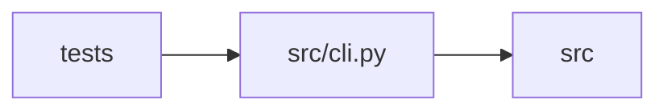

# cli Module

**Path:** `src/cli.py`

## Description

autoresearch CLI — operator entry points (P2 Skill SDK).

``autoresearch new-skill --goal "..."`` wraps the Phase-5 generator machinery
(``SkillGenerator`` + the ``PluginRunner`` dry-bootstrap preview +
``SkillRegistryPromotionTarget`` promotion) into one operator command, so a new
research domain goes from a sentence to an installed, policy-audited skill
package without writing YAML by hand.

Design decisions (P1-007 house style):

* **argparse, zero new deps** — no click/typer in the repo; subcommands share
  one parser with a shared promote flag-group.
* **The CLI is operator-local.** No audit store, no HTTP surface: promotion
  confirmations are interactive (``--yes`` to skip), and critical
  command-policy findings block promotion unless ``--allow-critical``
  (mirrors the API's gate-keeping posture — the operator is the approval).
* **``--dry-run`` reuses the generator's existing seam.** The draft is
  generated into a throwaway ``drafts_root_override`` dir; nothing under
  ``skills/`` is touched.
* **``--dry-bootstrap`` is the T5 overlay preview.** The generated
  ``bootstrap.py`` executes under ``PluginRunner``'s strictest workspace caps
  into a temp preview dir; the rendered file tree is printed, then discarded.
* **Promotion records a git tag when it can.** ``skill/<id>/<version>`` is
  created best-effort (skills tree inside a git repo); failures warn and
  continue — a docker deployment without git must still promote.

## Imports

| Source | Symbols |
|--------|---------|
| `__future__` | `annotations` |
| `argparse` | `argparse` |
| `asyncio` | `asyncio` |
| `pathlib` | `Path` |
| `shutil` | `shutil` |
| `src.agent_cli` | `build_agent_parser`, `cmd_agent` |
| `src.config` | `settings`, `settings` |
| `src.core.llm_provider` | `build_provider` |
| `src.core.objective_comparator` | `reconcile_historical_best` |
| `src.core.plugin_runner` | `PluginRunner` |
| `src.core.promotion_target` | `SkillPromotionError`, `SkillRegistryPromotionTarget`, `SkillRegistryPromotionTarget` |
| `src.core.results_store` | `ResultsStore` |
| `src.core.skill_generator` | `CommandPolicyFinding`, `SkillGenerationError`, `SkillGenerator`, `audit_command_policy` |
| `src.core.skill_loader` | `load_skill_manifest` |
| `src.core.skill_manifest` | `PluginCaps` |
| `subprocess` | `subprocess` |
| `sys` | `sys` |
| `tempfile` | `tempfile` |
| `typing` | `TYPE_CHECKING`, `Any`, `Optional` |

## Local dependency map

<!-- Auto-generated local dependency summary. Do not edit by hand. -->

> Module-level dependencies exceed the generated-diagram limits, so the diagram and table below group them by top-level package. Counts report the number of module neighbors in each package.

### Internal neighbors

| Direction | Module |
|---|---|
| Inbound | `tests` (3) |
| Outbound | `src` (10) |

> All 13 module neighbor(s) are summarized by package because the module-level view exceeds the 12-node limit.

## Functions

| Function | Signature | Decorators | Description |
|----------|-----------|------------|-------------|
| `build_parser` | `() -> argparse.ArgumentParser` | — | — |
| `_add_promote_flags` | `(p: argparse.ArgumentParser, *, inline: bool) -> None` | — | — |
| `_print_draft_report` | `(draft: Any, *, dry_run: bool) -> None` | — | — |
| `_print_findings` | `(findings: list[Any]) -> None` | — | — |
| `_confirm` | `(question: str, *, yes: bool) -> bool` | — | — |
| `cmd_new_skill` | *(async)* `(args: argparse.Namespace) -> int` | — | — |
| `_preview_bootstrap` | *(async)* `(draft_dir: Path) -> None` | — | Run the draft bootstrap.py under strict caps; print the rendered tree. |
| `_promote_flow` | *(async)* `(*, skill_id: str, findings: list[Any], args: argparse.Namespace) -> int` | — | — |
| `_tag_promoted_skill` | `(skill_id: str, stable_dir: Path) -> None` | — | Best-effort annotated git tag ``skill/<id>/<version>`` for the promotion. |
| `cmd_promote_skill` | *(async)* `(args: argparse.Namespace) -> int` | — | — |
| `cmd_reconcile_bests` | *(async)* `(args: argparse.Namespace) -> int` | — | Report (or with --apply, migrate) historical bests under known objectives. |
| `main` | `(argv: Optional[list[str]] = None) -> int` | — | — |
