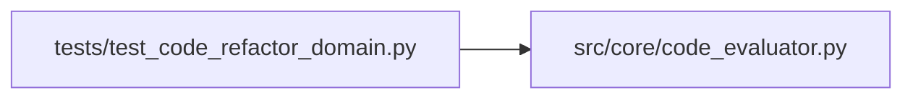

# code_evaluator Module

**Path:** `src/core/code_evaluator.py`

## Description

The isolated code evaluator: real tests, lint, and types.

A candidate bundle is a set of file contents for named target files in a
fixture project. The evaluator copies the project to an isolated work
directory, applies the bundle with test files and evaluation entrypoints
protected (candidate edits to them are reverted — editing tests can never
improve a result), and runs the real fixed tests, lint, and type checks
with bounded time. Performance is measured only where a controlled
benchmark exists; a required-but-unmeasured performance gate is a
rejection, never a pass.

## Imports

| Source | Symbols |
|--------|---------|
| `__future__` | `annotations` |
| `dataclasses` | `asdict`, `dataclass`, `field` |
| `hashlib` | `hashlib` |
| `json` | `json` |
| `pathlib` | `Path` |
| `shutil` | `shutil` |
| `subprocess` | `subprocess` |
| `sys` | `sys` |
| `tempfile` | `tempfile` |
| `time` | `time` |
| `typing` | `Any`, `Mapping`, `Optional`, `Sequence` |

## Local dependency map

<!-- Auto-generated local dependency summary. Do not edit by hand. -->

### Internal neighbors

| Direction | Module |
|---|---|
| Inbound | [test_code_refactor_domain](../modules/test_code_refactor_domain.md) |

## Classes

| Class | Line | Bases | Description |
|-------|------|-------|-------------|
| [CandidateBundle](../entities/CandidateBundle.md) | 32 | — | A multi-file candidate: named target files with full contents. |
| [EvalRequirements](../entities/EvalRequirements.md) | 47 | — | Explicit gates: tests, lint, types, and optional performance. |
| [EvalReport](../entities/EvalReport.md) | 59 | — | The trusted evaluator's report: real evidence, honest gaps. |

## Functions

| Function | Signature | Decorators | Description |
|----------|-----------|------------|-------------|
| `is_protected` | `(path: str) -> bool` | — | — |
| `apply_bundle` | `(project_root: Path, bundle: CandidateBundle, workdir: Path) -> tuple[Path, tuple[str, ...]]` | — | Copy the project and apply the bundle; protected files revert. |
| `_run` | `(command: Sequence[str], *, cwd: Path, timeout_s: float) -> tuple[int, str, bool]` | — | Run one real check with a bounded timeout. Returns (exit, out, timed_out). |
| `_parse_test_report` | `(output: str) -> dict[str, Any]` | — | — |
| `evaluate_bundle` | `(project_root: Path, bundle: CandidateBundle, requirements: EvalRequirements, *, workdir: Optional[Path] = None, timeout_s: float = DEFAULT_TIMEOUT_S) -> EvalReport` | — | Evaluate a bundle against the fixed gates with real tooling. |
| `promotion_preview` | `(*, bundle: CandidateBundle, report: EvalReport) -> dict[str, Any]` | — | Artifact-bound promotion: the report travels with its bundle. |
