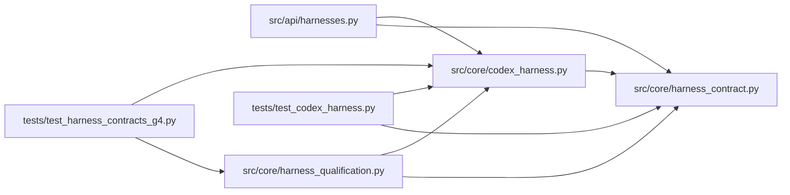

# codex_harness Module

**Path:** `src/core/codex_harness.py`

## Description

Codex harness adapter: the first independent external harness.

Interface choice (rechecked against the official non-interactive docs at
implementation time): ``codex exec --json`` — the least complex officially
supported structured interface. Its stdout is a JSONL event stream
(``thread.started``, ``turn.started``, ``item.*``, ``turn.completed`` with
usage, ``turn.failed``, ``error``) with progress on stderr.

Version pinning: the stream carries no schema version, so the adapter
pins the documented field shape (post-v0.44.0: ``item.type`` and
``agent_message``), parses defensively through the normalizer, records
``codex --version`` and the transport at start, and refuses to run live
without the caller's opt-in.

Demonstrated features only: the exec transport demonstrates no native
pause/resume, so neither is advertised — the SDK refuses them explicitly
rather than pretending. Cancellation is process-group supervision, not a
native feature claim. The harness's own tools are ordinary tool access:
they are never evaluator execution and never promotion authority.

## Imports

| Source | Symbols |
|--------|---------|
| `__future__` | `annotations` |
| `dataclasses` | `dataclass`, `field` |
| `json` | `json` |
| `os` | `os` |
| `shutil` | `shutil` |
| `signal` | `signal` |
| `src.core.harness_contract` | `ATTACH_MODE_CONTINUATION`, `HARNESS_CONTRACT_VERSION`, `HarnessContractError`, `HarnessIdentity`, `HarnessLifecycleError` |
| `subprocess` | `subprocess` |
| `threading` | `threading` |
| `time` | `time` |
| `typing` | `Any`, `Iterator`, `Mapping`, `Optional` |

## Local dependency map

<!-- Auto-generated local dependency summary. Do not edit by hand. -->

### Internal neighbors

| Direction | Module |
|---|---|
| Inbound | [harnesses](../modules/harnesses.md) |
| Inbound | [harness_qualification](../modules/harness_qualification.md) |
| Inbound | [test_codex_harness](../modules/test_codex_harness.md) |
| Inbound | [test_harness_contracts_g4](../modules/test_harness_contracts_g4.md) |
| Outbound | [harness_contract](../modules/harness_contract.md) |

## Classes

| Class | Line | Bases | Description |
|-------|------|-------|-------------|
| [CodexRunConfig](../entities/CodexRunConfig.md) | 75 | — | One supervised ``codex exec`` run. |
| [CodexHarnessAdapter](../entities/CodexHarnessAdapter.md) | 170 | — | The Codex harness behind the common contracts. |

## Functions

| Function | Signature | Decorators | Description |
|----------|-----------|------------|-------------|
| `normalize_codex_event` | `(raw: Mapping[str, Any]) -> dict[str, Any]` | — | Map one native Codex event into the common harness contracts. |
| `map_usage` | `(usage: Mapping[str, Any]) -> dict[str, Any]` | — | The Codex usage object into the common usage contract. |
| `map_candidate_changes` | `(events: list[dict[str, Any]]) -> list[dict[str, Any]]` | — | File-change items become candidate proposals (model-proposed). |
