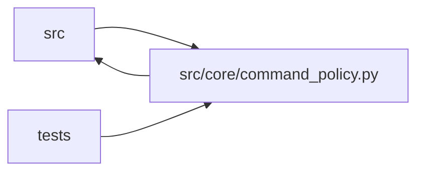

# command_policy Module

**Path:** `src/core/command_policy.py`

## Description

Command policy for the autoresearch agent's compatibility bash tool.

## Imports

| Source | Symbols |
|--------|---------|
| `__future__` | `annotations` |
| `dataclasses` | `dataclass`, `field`, `replace` |
| `hashlib` | `hashlib` |
| `os` | `os` |
| `pathlib` | `Path` |
| `shlex` | `shlex` |
| `src.core.execution_request` | `DISALLOWED_EXECUTABLES`, `FORBIDDEN_SUBSTRINGS`, `FORBIDDEN_TOKENS`, `PYTHON_BINDINGS`, `ExecutionRequest`, `resolve_execution_request`, `SECRET_MARKERS` |
| `src.core.fs_safety` | `FilesystemSafetyError`, `sha256_regular_file` |
| `src.core.result_authority` | `protected_result_names` |
| `src.core.tool_access` | `ToolAccessContext`, `build_tool_access_context` |
| `typing` | `Any`, `Iterable`, `Mapping`, `Optional` |

## Local dependency map

<!-- Auto-generated local dependency summary. Do not edit by hand. -->

> Module-level dependencies exceed the generated-diagram limits, so the diagram and table below group them by top-level package. Counts report the number of module neighbors in each package.

### Internal neighbors

| Direction | Module |
|---|---|
| Inbound | `src` (2) |
| Inbound | `tests` (6) |
| Outbound | `src` (4) |

> All 12 module neighbor(s) are summarized by package because the module-level view exceeds the 12-node limit.

## Classes

| Class | Line | Bases | Description |
|-------|------|-------|-------------|
| [CommandDecision](../entities/CommandDecision.md) | 45 | — | — |

## Functions

| Function | Signature | Decorators | Description |
|----------|-----------|------------|-------------|
| `evaluate_command_policy` | `(command: str, *, workspace_root: str, session_workspace: str \| None = None, policy_extension: Mapping[str, Iterable[str]] \| None = None, access: ToolAccessContext \| None = None, workdir: str \| None = None, timeout_s: int \| None = None) -> CommandDecision` | — | Resolve one command into an ExecutionRequest, then authorize it. |
| `_reject` | `(reason: str) -> CommandDecision` | — | — |
| `_allow` | `(argv: list[str], *, operation: str, execution_identity: dict[str, Any] \| None = None, request: ExecutionRequest \| None = None) -> CommandDecision` | — | — |
| `_pinned_interpreter` | `(workspace_root: str) -> str \| None` | — | Canonical absolute path of the sanctioned interpreter. |
| `_evaluation_data_digests` | `(names: Iterable[str], session_workspace: str \| None) -> dict[str, str]` | — | Digest the skill-declared evaluation data a launch will consume. |
| `_authorize_python_request` | `(request: ExecutionRequest, *, ext: Mapping[str, Any], workspace_root: str, session_workspace: str \| None, copyable_files: set[str], access: ToolAccessContext) -> CommandDecision` | — | Authorize a resolved python request and pin its execution identity. |
