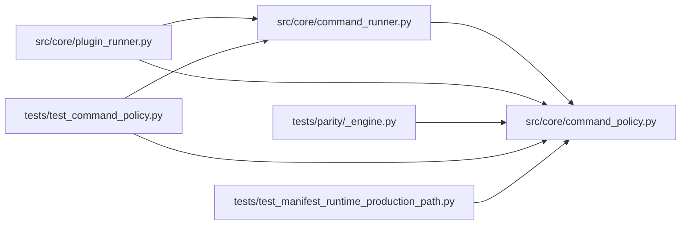

# command_policy Module

**Path:** `src/core/command_policy.py`

## Description

Command policy for the autoresearch agent's compatibility bash tool.

## Imports

| Source | Symbols |
|--------|---------|
| `__future__` | `annotations` |
| `dataclasses` | `dataclass`, `field` |
| `os` | `os` |
| `pathlib` | `Path` |
| `shlex` | `shlex` |
| `typing` | `Iterable`, `Mapping` |

## Local dependency map

<!-- Auto-generated local dependency summary. Do not edit by hand. -->

### Internal neighbors

| Direction | Module |
|---|---|
| Inbound | [command_runner](../modules/command_runner.md) |
| Inbound | [plugin_runner](../modules/plugin_runner.md) |
| Inbound | [_engine](../modules/_engine.md) |
| Inbound | [test_command_policy](../modules/test_command_policy.md) |
| Inbound | [test_manifest_runtime_production_path](../modules/test_manifest_runtime_production_path.md) |

## Classes

| Class | Line | Bases | Description |
|-------|------|-------|-------------|
| [CommandDecision](../entities/CommandDecision.md) | 52 | — | — |

## Functions

| Function | Signature | Decorators | Description |
|----------|-----------|------------|-------------|
| `evaluate_command_policy` | `(command: str, *, workspace_root: str, session_workspace: str \| None = None, policy_extension: Mapping[str, Iterable[str]] \| None = None) -> CommandDecision` | — | Parse and validate a single agent command before execution. |
| `_reject` | `(reason: str) -> CommandDecision` | — | — |
| `_allow` | `(argv: list[str], *, operation: str) -> CommandDecision` | — | — |
| `_strip_legacy_workspace_cd` | `(argv: list[str], workspace_root: str) -> list[str]` | — | — |
| `_shell_syntax_reason` | `(command: str, argv: Iterable[str]) -> str \| None` | — | — |
| `_secret_reference` | `(argv: Iterable[str]) -> str \| None` | — | — |
| `_is_allowed_python` | `(executable: str, workspace_root: str) -> bool` | — | — |
| `_evaluate_python` | `(argv: list[str], workspace_root: str, session_workspace: str \| None, *, allowed_scripts: set[str] \| None = None, copyable_files: set[str] \| None = None, script_paths: Mapping[str, str] \| None = None, config_flag: str = '--config') -> CommandDecision` | — | — |
| `_validate_prepare_config` | `(argv: list[str], script: str, workspace_root: str, session_workspace: str \| None, *, copyable_files: set[str] \| None = None, config_flag: str = '--config') -> str \| None` | — | Confine a script's config-artifact argument to the session workspace. |
| `_evaluate_cp` | `(argv: list[str], workspace_root: str, session_workspace: str \| None, *, copyable_files: set[str] \| None = None) -> CommandDecision` | — | — |
| `_evaluate_cat` | `(argv: list[str], workspace_root: str, session_workspace: str \| None, *, readable_files: set[str] \| None = None) -> CommandDecision` | — | — |
| `_workspace_relative` | `(path: str, workspace_root: str) -> str` | — | — |
| `_resolve_workspace_file` | `(raw: str, *, workspace_root: str, session_workspace: str \| None) -> str` | — | — |
| `_is_within` | `(path: str, directory: str) -> bool` | — | — |
