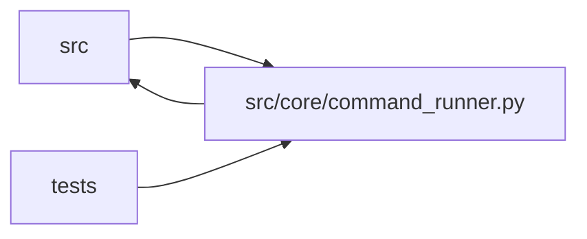

# command_runner Module

**Path:** `src/core/command_runner.py`

## Description

Governed subprocess runner for autoresearch agent commands.

## Imports

| Source | Symbols |
|--------|---------|
| `__future__` | `annotations` |
| `codecs` | `codecs` |
| `dataclasses` | `dataclass` |
| `fcntl` | `fcntl` |
| `os` | `os` |
| `pathlib` | `Path` |
| `psutil` | `psutil` |
| `re` | `re` |
| `selectors` | `selectors` |
| `signal` | `signal` |
| `src.core.command_policy` | `CommandDecision`, `evaluate_command_policy` |
| `src.core.isolation` | `IsolationPolicy` |
| `src.core.process_limits` | `TreeResourceGuard`, `terminate_process_tree` |
| `src.core.tool_access` | `ToolAccessContext` |
| `stat` | `stat` |
| `subprocess` | `subprocess` |
| `threading` | `threading` |
| `time` | `time` |
| `types` | `MappingProxyType` |
| `typing` | `TYPE_CHECKING`, `Any`, `Callable`, `Literal`, `Mapping` |
| `uuid` | `uuid` |

## Local dependency map

<!-- Auto-generated local dependency summary. Do not edit by hand. -->

> Module-level dependencies exceed the generated-diagram limits, so the diagram and table below group them by top-level package. Counts report the number of module neighbors in each package.

### Internal neighbors

| Direction | Module |
|---|---|
| Inbound | `src` (2) |
| Inbound | `tests` (8) |
| Outbound | `src` (4) |

### External packages

| Language | Used packages | Undeclared packages |
|---|---:|---:|
| python | 1 | 1 |

> All 14 module neighbor(s) are summarized by package because the module-level view exceeds the 12-node limit.

## Classes

| Class | Kind | Line | Bases / Target | Description |
|-------|------|------|----------------|-------------|
| [_HeadTailBuffer](../entities/HeadTailBuffer.md) | Class | 40 | — | Retain a fixed-size head and rolling tail, including for newline-free data. |
| [_SessionOutputLog](../entities/SessionOutputLog.md) | Class | 74 | — | Append child output under a shared session logs byte quota. |
| [OutputStream](../entities/OutputStream.md) | Type alias | 253 | `Literal['stdout', 'stderr']` | — |
| [OutputCallback](../entities/OutputCallback.md) | Type alias | 254 | `Callable[[OutputStream, str], None]` | — |
| [CommandRunResult](../entities/CommandRunResult.md) | Class | 258 | — | — |
| [CommandProcessRegistry](../entities/CommandProcessRegistry.md) | Class | 282 | — | Thread-safe registry of in-flight governed subprocesses, keyed by session. |
| [GovernedCommandRunner](../entities/GovernedCommandRunner.md) | Class | 344 | — | Validate and execute one approved command without invoking a shell. |

## Functions

| Function | Signature | Decorators | Description |
|----------|-----------|------------|-------------|
| `_build_child_env` | `(environ: Mapping[str, str] \| None = None) -> dict[str, str]` | — | Build the env dict handed to a governed subprocess (ARC-011 P0-023). |
| `redact_sensitive_text` | `(text: str) -> str` | — | Redact token-like values from command text and subprocess output. |
| `_combine_output` | `(stdout: str \| bytes \| None, stderr: str \| bytes \| None) -> str` | — | — |
| `_to_text` | `(value: str \| bytes) -> str` | — | — |
| `_collect_process_output` | `(proc: subprocess.Popen, *, timeout_s: float, workspace: str, output_callback: OutputCallback \| None = None, log: _SessionOutputLog \| None = None, resource_guard: 'TreeResourceGuard \| None' = None, max_output_bytes: int \| None = None) -> tuple[str, str, bool, str \| None, bool, str \| None, bool]` | — | Drain both pipes incrementally, without communicate(), threads or queues. |
| `_truncate_output` | `(output: str) -> str` | — | — |
| `_terminate_process_group_without_communicate` | `(proc: subprocess.Popen[str]) -> bool` | — | Terminate a timed-out process tree without accumulating pipe output. |
