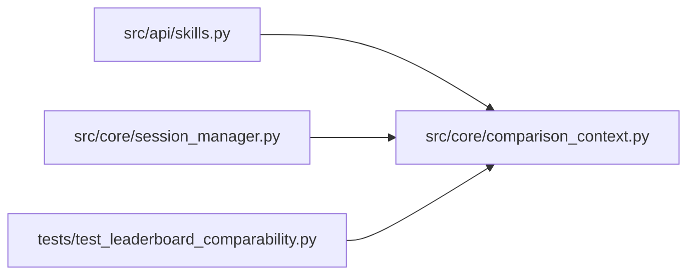

# comparison_context Module

**Path:** `src/core/comparison_context.py`

## Description

Comparable-context identity for result ranking.

Results rank only within one comparable context: the same objective and
units, the same dataset/scorer/fidelity pins, and matching subject and
variant constraints. Sessions whose context is unknown (legacy rows, or
runs that recorded no pins) stay in their own group — never merged into
a shared champion table, where a differing scorer or dataset could
manufacture a misleading winner.

## Imports

| Source | Symbols |
|--------|---------|
| `__future__` | `annotations` |
| `json` | `json` |
| `typing` | `Any`, `Mapping`, `Optional` |

## Local dependency map

<!-- Auto-generated local dependency summary. Do not edit by hand. -->

### Internal neighbors

| Direction | Module |
|---|---|
| Inbound | [src_api_skills](../modules/src_api_skills.md) |
| Inbound | [session_manager](../modules/session_manager.md) |
| Inbound | [test_leaderboard_comparability](../modules/test_leaderboard_comparability.md) |

## Functions

| Function | Signature | Decorators | Description |
|----------|-----------|------------|-------------|
| `build_comparison_context` | `(*, objective: str, units: str, subject: Optional[str] = None, variant: Optional[str] = None, pins: Optional[Mapping[str, Any]] = None) -> str` | — | Canonical, ordered identity: the grouping key for rankings. |
| `describe_comparison_context` | `(context: Optional[str]) -> dict[str, Any]` | — | The label a ranking surface shows for one comparable group. |
