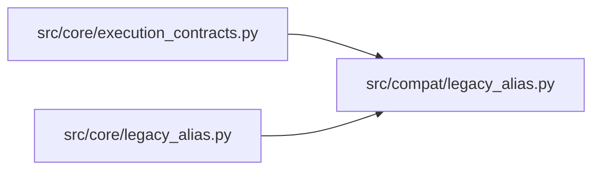

# legacy_alias Module

**Path:** `src/compat/legacy_alias.py`

## Description

Legacy alias registry (moved to src/compat — P1-2).

The back-compat bridge between the legacy ``model_type`` field
(``direction``/``volatility``/``rl``) and the canonical ``skill_id``
(``ml-direction``/``ml-volatility``/``ml-rl``). Legacy API callers that send
``model_type`` (ARC-011 §10 guarantee #5) are auto-translated to ``skill_id``
here; the orchestrator and SkillRuntime reach for ``skill_id`` only.

Historical vocabulary only — kept so pre-migration DB rows still render and
legacy API callers keep working. No new features.

Design note (P1-007 house style):

* The canonical manifest skill ids (``ml-direction`` etc.) are distinct from the
  legacy on-disk primer directory names (``direction-autotuner`` etc.) the
  transitional ``_SKILL_IDENTITY`` map in ``skill_runtime.py`` uses. This module
  owns the ``model_type ↔ manifest skill_id`` mapping; the primer-dir mapping
  is transitional and retired by P2-021. The two are reconciled here so callers
  can pass either form.

## Imports

| Source | Symbols |
|--------|---------|
| `__future__` | `annotations` |

## Local dependency map

<!-- Auto-generated local dependency summary. Do not edit by hand. -->

### Internal neighbors

| Direction | Module |
|---|---|
| Inbound | [execution_contracts](../modules/execution_contracts.md) |
| Inbound | [core_legacy_alias](../modules/core_legacy_alias.md) |

## Functions

| Function | Signature | Decorators | Description |
|----------|-----------|------------|-------------|
| `model_type_to_skill_id` | `(model_type: str) -> str` | — | Translate a legacy ``model_type`` to its canonical ``skill_id``. |
| `skill_id_to_model_type` | `(skill_id: str) -> str` | — | Translate a canonical ``skill_id`` back to its legacy ``model_type``. |
| `is_known_model_type` | `(model_type: str) -> bool` | — | Whether ``model_type`` maps to a Phase-2 skill (excludes ``pipeline``). |
