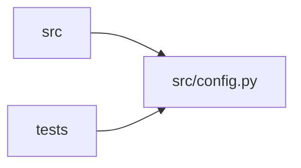

# config Module

**Path:** `src/config.py`

## Description

Configuration for the autoresearch-agent service.

## Imports

| Source | Symbols |
|--------|---------|
| `__future__` | `annotations` |
| `functools` | `lru_cache` |
| `logging` | `logging` |
| `pydantic` | `AliasChoices`, `Field`, `SecretStr` |
| `pydantic_settings` | `BaseSettings`, `SettingsConfigDict` |
| `typing` | `Any`, `List`, `Literal`, `Optional` |

## Local dependency map

<!-- Auto-generated local dependency summary. Do not edit by hand. -->

> Module-level dependencies exceed the generated-diagram limits, so the diagram and table below group them by top-level package. Counts report the number of module neighbors in each package.

### Internal neighbors

| Direction | Module |
|---|---|
| Inbound | `src` (16) |
| Inbound | `tests` (22) |

### External packages

| Language | Used packages | Undeclared packages |
|---|---:|---:|
| python | 2 | 0 |

> All 38 module neighbor(s) are summarized by package because the module-level view exceeds the 12-node limit.

## Classes

| Class | Line | Bases | Description |
|-------|------|-------|-------------|
| [Settings](../entities/Settings.md) | 30 | `BaseSettings` | Application settings loaded from environment variables. |

## Functions

| Function | Signature | Decorators | Description |
|----------|-----------|------------|-------------|
| `secret_value` | `(value: SecretStr \| str \| None) -> str \| None` | — | Return a plain string for secret values at API/client boundaries. |
| `get_settings` | `() -> Settings` | `@lru_cache(maxsize=1)` | Return the cached service settings instance. |
