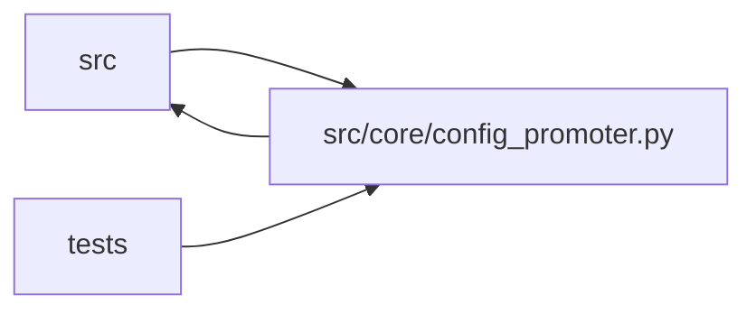

# config_promoter Module

**Path:** `src/core/config_promoter.py`

## Description

Config promoter — previews and writes winning configs to the host bind mount.

## Imports

| Source | Symbols |
|--------|---------|
| `__future__` | `annotations` |
| `asyncio` | `asyncio` |
| `datetime` | `datetime`, `timezone` |
| `hashlib` | `hashlib` |
| `httpx` | `httpx` |
| `json` | `json`, `_json` |
| `logging` | `logging` |
| `math` | `math` |
| `os` | `os` |
| `pathlib` | `Path` |
| `src.config` | `secret_value`, `settings` |
| `src.core.artifact_reference` | `first_valid_artifact_ref`, `normalize_artifact_references_in_mapping`, `normalize_optional_artifact_ref` |
| `src.core.blocker_classifier` | `classify_blockers` |
| `src.core.consistency_validator` | `build_consistency_report` |
| `src.core.development_gate_bundle` | `evaluate_development_gate_bundle`, `load_gate_bundle`, `load_production_gate_bundle` |
| `src.core.development_inference_validation` | `build_development_inference_validation` |
| `src.core.development_signal_health` | `build_development_signal_health` |
| `src.core.gate_status` | `training_gates_passed_from_iteration` |
| `src.core.legacy_alias` | `model_type_to_skill_id` |
| `src.core.objective_comparator` | `ObjectiveComparator`, `objective_comparator_for_skill_id` |
| `src.core.promotion_approval` | `target_identity`, `validate_candidate_binding`, `target_identity`, `canonical_json` |
| `src.core.promotion_policy` | `SCOPE_EVIDENCE_VALIDATORS`, `ScopePolicyError`, `compile_scope_graph`, `scope_requirements` |
| `src.core.promotion_target` | `FilePathPromotionTarget`, `PromotionTarget`, `WebhookPromotionTarget`, `WebhookPromotionTarget`, `WebhookPromotionTarget` |
| `src.core.research_phase_plan` | `build_phase_state` |
| `src.core.significance` | `best_other_config_hash`, `qualification_status`, `samples_from_rows`, `significance_verdict` |
| `src.core.skill_registry` | `default_registry`, `default_registry`, `default_registry` |
| `src.core.state_store` | `StateStore` |
| `subprocess` | `subprocess` |
| `tempfile` | `tempfile` |
| `typing` | `Any`, `Dict`, `List`, `Mapping`, `Optional` |
| `yaml` | `yaml` |

## Local dependency map

<!-- Auto-generated local dependency summary. Do not edit by hand. -->

> Module-level dependencies exceed the generated-diagram limits, so the diagram and table below group them by top-level package. Counts report the number of module neighbors in each package.

### Internal neighbors

| Direction | Module |
|---|---|
| Inbound | `src` (3) |
| Inbound | `tests` (16) |
| Outbound | `src` (17) |

### External packages

| Language | Used packages | Undeclared packages |
|---|---:|---:|
| python | 2 | 0 |

> All 36 module neighbor(s) are summarized by package because the module-level view exceeds the 12-node limit.

## Classes

| Class | Line | Bases | Description |
|-------|------|-------|-------------|
| [ConfigPromoter](../entities/ConfigPromoter.md) | 142 | — | Handles preview and confirmation of config promotion to host. |

## Functions

| Function | Signature | Decorators | Description |
|----------|-----------|------------|-------------|
| `_has_smoke_validation_evidence` | `(metrics: Dict[str, Any]) -> bool` | — | True when a passing smoke/paper validation is already in the metrics — |
| `_atomic_write_text` | `(path: str, content: str) -> None` | — | Sync helper: tmp+fsync+os.replace atomic write. |
| `_session_skill_manifest` | `(skill_id: str)` | — | The installed skill manifest for a session's skill id, or ``None``. |
