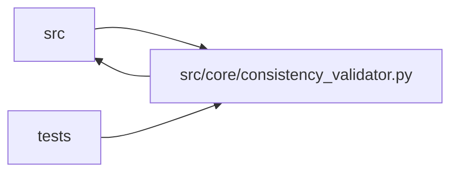

# consistency_validator Module

**Path:** `src/core/consistency_validator.py`

## Description

Cross-service consistency validation for autoresearch candidates.

## Imports

| Source | Symbols |
|--------|---------|
| `__future__` | `annotations` |
| `datetime` | `datetime`, `timezone` |
| `hashlib` | `hashlib` |
| `json` | `json` |
| `logging` | `logging` |
| `src.core.artifact_reference` | `first_valid_artifact_ref`, `is_sentinel_artifact_ref`, `normalize_optional_artifact_ref` |
| `src.core.gate_status` | `training_gates_passed_from` |
| `typing` | `Any`, `Dict`, `Iterable`, `Optional`, `Set` |

## Local dependency map

<!-- Auto-generated local dependency summary. Do not edit by hand. -->

> Module-level dependencies exceed the generated-diagram limits, so the diagram and table below group them by top-level package. Counts report the number of module neighbors in each package.

### Internal neighbors

| Direction | Module |
|---|---|
| Inbound | `src` (6) |
| Inbound | `tests` (6) |
| Outbound | `src` (2) |

> All 14 module neighbor(s) are summarized by package because the module-level view exceeds the 12-node limit.

## Functions

| Function | Signature | Decorators | Description |
|----------|-----------|------------|-------------|
| `_normalize_report_mode` | `(mode: Optional[str]) -> Optional[str]` | — | — |
| `build_consistency_report` | `(*, research_id: str, iteration: int, model_type: str, config_snapshot: Optional[str], metrics_payload: Optional[Dict[str, Any]] = None, attempt_snapshot: Optional[Dict[str, Any]] = None, preflight: Optional[Dict[str, Any]] = None, search_phase: Optional[str] = None, mode: Optional[str] = None, serving_evidence_required: bool = True) -> Dict[str, Any]` | — | Build a readable cross-service candidate consistency report. |
| `check_adaptive_feature_sweep` | `(metrics: Dict[str, Any]) -> Optional[str]` | — | Return None when adaptive feature evidence proves a real or accepted sweep. |
| `consistency_report_json` | `(report: Dict[str, Any]) -> str` | — | — |
| `parse_consistency_report` | `(raw: Any) -> Optional[Dict[str, Any]]` | — | — |
| `check_evidence_artifact` | `(metrics: Dict[str, Any], phase_id: str, *, prior_run_ids: Optional[Set[str]] = None) -> Optional[str]` | — | Return None on pass or a blocker string on failure. |
| `_is_synthetic_promotion_iteration` | `(metrics: Dict[str, Any], prior_best_metrics: Dict[str, Any], phase_id: str) -> Optional[str]` | — | Return a blocker string when an iteration appears synthetic (no real work ran). |
| `_calibration_payload` | `(metrics: Dict[str, Any]) -> Optional[Dict[str, Any]]` | — | — |
| `_adaptive_feature_evidence` | `(metrics: Dict[str, Any]) -> Dict[str, Any]` | — | — |
| `_adaptive_schema_flags_blocker` | `(metrics: Dict[str, Any]) -> Optional[str]` | — | — |
| `_feature_schema_flags` | `(metrics: Dict[str, Any]) -> Dict[str, Any]` | — | — |
| `_nested_bool` | `(container: Any, path: Iterable[str]) -> Optional[bool]` | — | — |
| `_all_true` | `(container: Dict[str, Any], keys: Iterable[str]) -> Optional[bool]` | — | — |
| `_first_present` | `(primary: Dict[str, Any], secondary: Dict[str, Any], *keys: str) -> Any` | — | — |
| `_first_non_none` | `(*values: Any) -> Any` | — | — |
| `_int_value` | `(value: Any, *, default: int = 0) -> int` | — | — |
| `_sha256_text` | `(value: Any) -> Optional[str]` | — | — |
| `_dedupe` | `(values: Iterable[str]) -> list[str]` | — | — |
| `_dict_at` | `(root: Any, *path: str) -> Dict[str, Any]` | — | — |
| `_first_dict` | `(*values: Any) -> Dict[str, Any]` | — | — |
| `_first_number` | `(*values: Any) -> Optional[float]` | — | — |
| `_rl_channel_provenance` | `(metrics: Dict[str, Any], rl_oos: Dict[str, Any], channel: str) -> Dict[str, Any]` | — | — |
| `_rl_feature_bundle_hash` | `(metrics: Dict[str, Any], rl_oos: Dict[str, Any]) -> Optional[str]` | — | — |
| `_rl_economic_replay_payload` | `(metrics: Dict[str, Any]) -> Optional[Dict[str, Any]]` | — | — |
| `_rl_replay_assumptions_present` | `(replay: Dict[str, Any]) -> bool` | — | — |
| `_rl_replay_worse_than_baseline` | `(replay: Dict[str, Any]) -> list[Dict[str, Any]]` | — | — |
| `_rl_nested_validation_present` | `(rl_oos: Dict[str, Any]) -> bool` | — | — |
| `_rl_multi_seed_present` | `(rl_oos: Dict[str, Any]) -> bool` | — | — |
| `_rl_required_metrics_present` | `(rl_oos: Dict[str, Any]) -> bool` | — | — |
| `_rl_metric_value` | `(metrics: Dict[str, Any], name: str) -> Optional[float]` | — | — |
| `_rl_unsafe_feature_provenance` | `(provenance: Dict[str, Any]) -> bool` | — | — |
| `_string_list` | `(value: Any) -> list[str]` | — | — |
| `_truthy` | `(value: Any) -> bool` | — | — |
