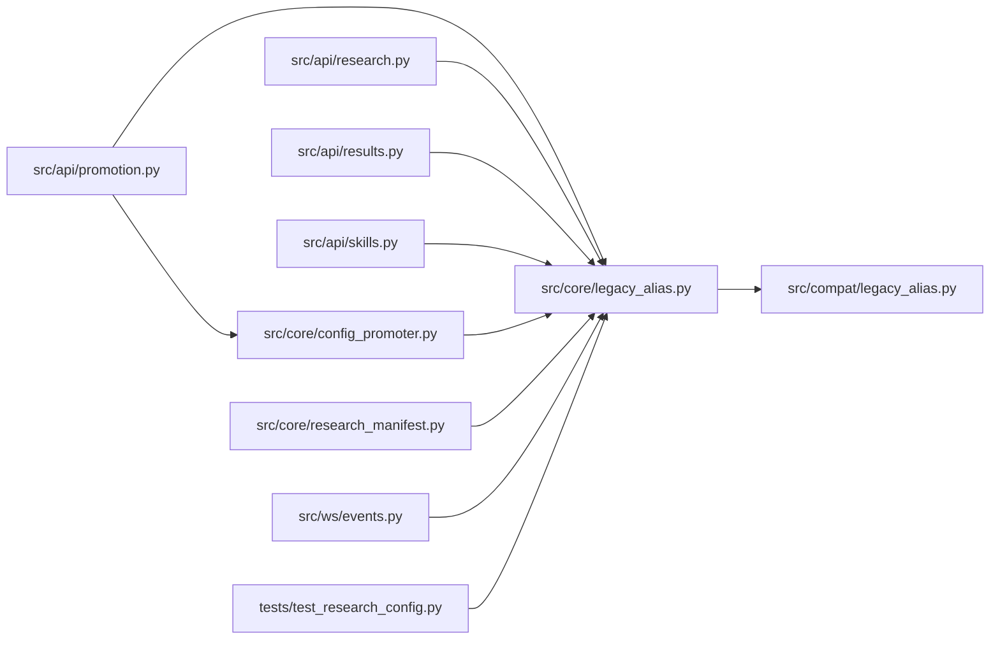

# legacy_alias Module

**Path:** `src/core/legacy_alias.py`

## Description

Back-compat shim (P1-2): the legacy alias registry moved to
src/compat/legacy_alias.py; every importer keeps working.

## Imports

| Source | Symbols |
|--------|---------|
| `src.compat.legacy_alias` | `is_known_model_type`, `model_type_to_skill_id`, `skill_id_to_model_type` |

## Local dependency map

<!-- Auto-generated local dependency summary. Do not edit by hand. -->

### Internal neighbors

| Direction | Module |
|---|---|
| Inbound | [promotion](../modules/promotion.md) |
| Inbound | [research](../modules/research.md) |
| Inbound | [results](../modules/results.md) |
| Inbound | [src_api_skills](../modules/src_api_skills.md) |
| Inbound | [config_promoter](../modules/config_promoter.md) |
| Inbound | [research_manifest](../modules/research_manifest.md) |
| Inbound | [events](../modules/events.md) |
| Inbound | [test_research_config](../modules/test_research_config.md) |
| Outbound | [compat_legacy_alias](../modules/compat_legacy_alias.md) |
