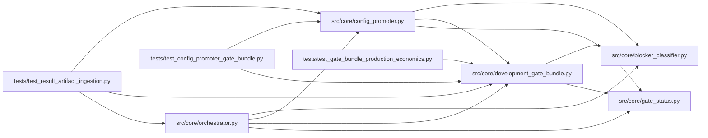

# development_gate_bundle Module

**Path:** `src/core/development_gate_bundle.py`

## Description

Development gate bundle evaluation for autoresearch promotions.

## Imports

| Source | Symbols |
|--------|---------|
| `__future__` | `annotations` |
| `copy` | `copy` |
| `json` | `json` |
| `pathlib` | `Path` |
| `src.core.blocker_classifier` | `classify_blockers` |
| `src.core.gate_status` | `training_gates_passed_from_iteration` |
| `typing` | `Any`, `Dict`, `Iterable` |
| `yaml` | `yaml` |

## Local dependency map

<!-- Auto-generated local dependency summary. Do not edit by hand. -->

### Internal neighbors

| Direction | Module |
|---|---|
| Inbound | [config_promoter](../modules/config_promoter.md) |
| Inbound | [orchestrator](../modules/orchestrator.md) |
| Inbound | [test_config_promoter_gate_bundle](../modules/test_config_promoter_gate_bundle.md) |
| Inbound | [test_gate_bundle_production_economics](../modules/test_gate_bundle_production_economics.md) |
| Inbound | [test_result_artifact_ingestion](../modules/test_result_artifact_ingestion.md) |
| Outbound | [blocker_classifier](../modules/blocker_classifier.md) |
| Outbound | [gate_status](../modules/gate_status.md) |

### External packages

| Language | Used packages | Undeclared packages |
|---|---:|---:|
| python | 1 | 0 |

## Functions

| Function | Signature | Decorators | Description |
|----------|-----------|------------|-------------|
| `load_gate_bundle` | `(workspace_root: str \| Path) -> dict[str, Any]` | — | Load the versioned development gate bundle from the workspace. |
| `load_production_gate_bundle` | `(workspace_root: str \| Path) -> dict[str, Any]` | — | Load the versioned production-scope promotion gate bundle. |
| `_load_bundle` | `(path: Path) -> dict[str, Any]` | — | — |
| `evaluate_development_gate_bundle` | `(*, bundle: dict[str, Any], model_type: str, best_iteration: dict[str, Any]) -> dict[str, Any]` | — | Evaluate a best autoresearch iteration against the gate bundle. |
| `_iteration_payload` | `(best_iteration: dict[str, Any]) -> dict[str, Any]` | — | — |
| `_waivers` | `(payload: dict[str, Any]) -> set[str]` | — | — |
| `_evaluate_rl_development_gate_bundle` | `(*, bundle: dict[str, Any], model_type: str, best_iteration: dict[str, Any]) -> dict[str, Any]` | — | Evaluate server-owned RL promotion gates for development promotion. |
| `_dict_at` | `(root: Any, *path: str) -> dict[str, Any]` | — | — |
| `_dict_or_list` | `(root: Any, *path: str) -> Any` | — | — |
| `_first_dict` | `(*values: Any) -> dict[str, Any]` | — | — |
| `_first_number` | `(*values: Any) -> float \| None` | — | — |
| `_max_number` | `(*values: Any) -> float \| None` | — | — |
| `_resolved_operating_signal_rate` | `(*, metrics: dict[str, Any], gates: dict[str, Any], config: dict[str, Any], payload: dict[str, Any]) -> float \| None` | — | DM-3: resolve the *deployed* operating signal rate for gate comparison. |
| `_append_blocker` | `(blockers: list[str], reason: str) -> None` | — | — |
| `_post_cost_replay_worsening_details` | `(replay: dict[str, Any], replay_gates: dict[str, Any]) -> dict[str, Any]` | — | Detect explicit post-cost replay worsening versus baseline evidence. |
| `_evaluate_rl_economic_replay_gates` | `(*, bundle: dict[str, Any], payload: dict[str, Any], checks: list[dict[str, Any]], blockers: list[str], waivers: set[str], add_check: Any) -> None` | — | Evaluate first-class RL post-cost economic replay evidence. |
| `_rl_economic_replay_payload` | `(payload: dict[str, Any]) -> dict[str, Any]` | — | — |
| `_rl_economic_replay_metrics` | `(replay: dict[str, Any]) -> dict[str, Any]` | — | — |
| `_rl_economic_metric_value` | `(metrics: dict[str, Any], name: str) -> float \| None` | — | — |
| `_requested_promotion_scope` | `(payload: dict[str, Any]) -> str` | — | — |
| `_live_production_promotion_requested` | `(payload: dict[str, Any]) -> bool` | — | — |
| `_evaluate_rollback_readiness_gates` | `(*, bundle: dict[str, Any], payload: dict[str, Any], add_check: Any) -> None` | — | Evaluate rollback readiness evidence for development promotion. |
| `_evaluate_signal_health_gates` | `(*, bundle: dict[str, Any], payload: dict[str, Any], add_check: Any) -> None` | — | Evaluate development direction-signal health monitoring evidence. |
| `_evaluate_inference_reload_gates` | `(*, bundle: dict[str, Any], payload: dict[str, Any], add_check: Any) -> None` | — | Evaluate DPU-073 inference reload/parity validation evidence. |
| `_evaluate_smoke_validation_gates` | `(*, bundle: dict[str, Any], payload: dict[str, Any], add_check: Any) -> None` | — | Evaluate smoke or paper validation evidence before promotion. |
| `_evaluate_inference_parity_gates` | `(*, bundle: dict[str, Any], payload: dict[str, Any], add_check: Any) -> None` | — | Evaluate required inference parity evidence for development promotion. |
| `_bool_field` | `(container: dict[str, Any], *keys: str) -> bool` | — | — |
| `_is_tsfm_candidate` | `(payload: dict[str, Any], inference: dict[str, Any]) -> bool` | — | — |
| `_evaluate_rl_oos_gates` | `(*, bundle: dict[str, Any], payload: dict[str, Any], checks: list[dict[str, Any]], blockers: list[str], waivers: set[str], add_check: Any, require_feature_provenance: bool = False) -> None` | — | Evaluate DPU-063 RL OOS gate evidence when a candidate is a finalist. |
| `_evaluate_rl_feature_provenance_gate` | `(*, channel: str, provenance: dict[str, Any], checks: list[dict[str, Any]], blockers: list[str], waivers: set[str]) -> None` | — | — |
| `_rl_channel_provenance` | `(payload: dict[str, Any], rl_oos: dict[str, Any], channel: str) -> dict[str, Any]` | — | — |
| `_rl_feature_bundle_hash` | `(payload: dict[str, Any], rl_oos: dict[str, Any]) -> str \| None` | — | — |
| `_rl_required_provenance_fields_missing` | `(provenance: dict[str, Any]) -> list[str]` | — | — |
| `_present_value` | `(value: Any) -> bool` | — | — |
| `_rl_unsafe_feature_details` | `(provenance: dict[str, Any]) -> dict[str, Any]` | — | — |
| `_rl_stale_or_leaked_details` | `(provenance: dict[str, Any]) -> dict[str, Any]` | — | — |
| `_provenance_status_values` | `(provenance: dict[str, Any]) -> list[str]` | — | — |
| `_string_list` | `(value: Any) -> list[str]` | — | — |
| `_truthy` | `(value: Any) -> bool` | — | — |
| `_boolean_gate` | `(*, checks: list[dict[str, Any]], blockers: list[str], waivers: set[str], name: str, passed: bool, reason: str, details: Any = None) -> None` | — | — |
| `_rl_nested_validation_present` | `(rl_oos: dict[str, Any]) -> bool` | — | — |
| `_rl_metric_value` | `(metrics: dict[str, Any], name: str) -> float \| None` | — | — |
| `_rl_multi_seed_present` | `(rl_oos: dict[str, Any]) -> bool` | — | — |
| `_numeric_gate` | `(*, checks: list[dict[str, Any]], blockers: list[str], waivers: set[str], name: str, value: float \| None, threshold: Any, comparator: str, reason: str) -> None` | — | — |
