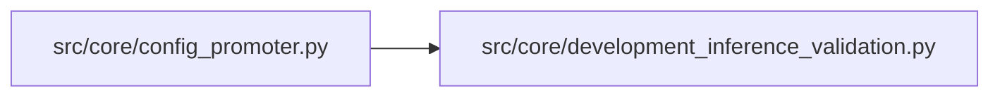

# development_inference_validation Module

**Path:** `src/core/development_inference_validation.py`

## Description

Inference reload/parity validation summaries for development promotion.

## Imports

| Source | Symbols |
|--------|---------|
| `__future__` | `annotations` |
| `typing` | `Any`, `Dict` |

## Local dependency map

<!-- Auto-generated local dependency summary. Do not edit by hand. -->

### Internal neighbors

| Direction | Module |
|---|---|
| Inbound | [config_promoter](../modules/config_promoter.md) |

## Functions

| Function | Signature | Decorators | Description |
|----------|-----------|------------|-------------|
| `build_development_inference_validation` | `(*, metrics_payload: Dict[str, Any], rollback_readiness: Dict[str, Any], smoke_validation: Dict[str, Any]) -> Dict[str, Any]` | — | Normalize DPU-073 inference parity and reload evidence. |
| `_first_dict` | `(*values: Any) -> Dict[str, Any]` | — | — |
| `_bool_field` | `(container: Dict[str, Any], *keys: str) -> bool` | — | — |
| `_is_tsfm_candidate` | `(metrics_payload: Dict[str, Any], inference: Dict[str, Any]) -> bool` | — | — |
