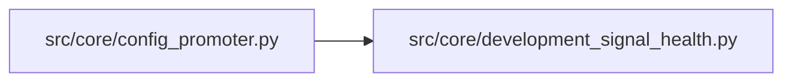

# development_signal_health Module

**Path:** `src/core/development_signal_health.py`

## Description

Development direction-signal health summaries for promotion metadata.

## Imports

| Source | Symbols |
|--------|---------|
| `__future__` | `annotations` |
| `math` | `math` |
| `typing` | `Any`, `Dict`, `Iterable` |

## Local dependency map

<!-- Auto-generated local dependency summary. Do not edit by hand. -->

### Internal neighbors

| Direction | Module |
|---|---|
| Inbound | [config_promoter](../modules/config_promoter.md) |

## Functions

| Function | Signature | Decorators | Description |
|----------|-----------|------------|-------------|
| `build_development_signal_health` | `(metrics_payload: Dict[str, Any]) -> Dict[str, Any]` | — | Build observable direction-signal health metrics for development promotion. |
| `_probability_summary` | `(probabilities: list[float], *, threshold: float) -> Dict[str, Any]` | — | — |
| `_build_drift` | `(*, raw: Dict[str, Any], current: Dict[str, Any], training: Dict[str, Any]) -> Dict[str, Any]` | — | — |
| `_build_alerts` | `(*, summary: Dict[str, Any], operational: Dict[str, Any], drift: Dict[str, Any]) -> list[dict[str, Any]]` | — | — |
| `_binary_entropy` | `(probability: float) -> float` | — | — |
| `_base_disagreement` | `(values: Any) -> float \| None` | — | — |
| `_psi` | `(current: list[float], training: list[float]) -> float` | — | — |
| `_kl` | `(current: list[float], training: list[float]) -> float` | — | — |
| `_normalize_histogram` | `(values: list[float]) -> list[float]` | — | — |
| `_number_list` | `(*values: Any) -> list[float]` | — | — |
| `_dict_at` | `(root: Any, *path: str) -> Dict[str, Any]` | — | — |
| `_first_dict` | `(*values: Any) -> Dict[str, Any]` | — | — |
| `_first_number` | `(*values: Any) -> float \| None` | — | — |
| `_first_bool` | `(*values: Any) -> bool \| None` | — | — |
