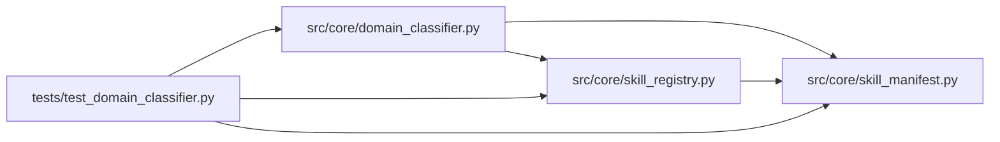

# domain_classifier Module

**Path:** `src/core/domain_classifier.py`

## Description

Embedding-based domain classifier (ARC-011 P5-016 / P5-018 / P5-019).

Ranks installed skills by similarity to a natural-language ``goal`` so that
``POST /research/start`` can accept a goal instead of a ``skill_id`` (P5-017).
The top match is auto-selected when its score clears ``auto_select_threshold``
(P5-019); otherwise the caller surfaces the candidate list for operator
confirmation.

Strategy decision (per ARC-011 Phase-5 plan): **lexical-first**. TF-IDF over
hashed word + char n-grams, cosine similarity, stdlib + numpy only. Zero new
heavy deps, deterministic, offline, fast. A swappable ``EmbeddingBackend``
Protocol lets an LLM-embeddings backend drop in later without touching callers
(the ``LLMEmbeddingBackend`` stub is documented but not implemented this phase).

Design decisions (P1-007 house style):

* **Backend Protocol.** ``EmbeddingBackend.embed(text) -> Sequence[float]``;
  ``LexicalEmbeddingBackend`` is the default. Callers depend on the Protocol,
  not the impl, so a semantic backend can replace the lexical one behind the
  same ``DomainClassifier``.
* **Cache on install/reload.** Skill embeddings are computed once and cached
  (keyed on skill_id + a content hash of the embedded text); invalidation is
  the caller's job (the registry's ``reload_all`` / install path). The cache
  persists as JSON next to the registry root so it survives restarts (P5-016
  AC #3).
* **Cold-start graceful degradation.** Fewer than ``_MIN_SKILLS_FOR_AUTOSELECT``
  installed skills, or a top score below threshold, ⇒ ``confidence="low"`` and
  the caller surfaces "list all, let operator pick" (P5-016 risks).
* **Audit is the caller's job.** ``classify`` returns a ``ClassificationResult``;
  the caller writes the ``skill.classify`` audit row (P5-018). Keeps the
  classifier free of the DB handle.

## Imports

| Source | Symbols |
|--------|---------|
| `__future__` | `annotations` |
| `dataclasses` | `dataclass`, `field` |
| `hashlib` | `hashlib` |
| `json` | `json` |
| `logging` | `logging` |
| `math` | `math` |
| `numpy` | `np` |
| `numpy.linalg` | `norm` |
| `pathlib` | `Path` |
| `re` | `re` |
| `src.core.skill_manifest` | `ResearchSkillManifest` |
| `src.core.skill_registry` | `SkillRegistry` |
| `typing` | `Any`, `Optional`, `Protocol`, `Sequence` |

## Local dependency map

<!-- Auto-generated local dependency summary. Do not edit by hand. -->

### Internal neighbors

| Direction | Module |
|---|---|
| Inbound | [test_domain_classifier](../modules/test_domain_classifier.md) |
| Outbound | [skill_manifest](../modules/skill_manifest.md) |
| Outbound | [skill_registry](../modules/skill_registry.md) |

### External packages

| Language | Used packages | Undeclared packages |
|---|---:|---:|
| python | 1 | 0 |

## Classes

| Class | Line | Bases | Description |
|-------|------|-------|-------------|
| [EmbeddingBackend](../entities/EmbeddingBackend.md) | 73 | `Protocol` | Pluggable text embedding (P5-016). |
| [LexicalEmbeddingBackend](../entities/LexicalEmbeddingBackend.md) | 92 | — | TF-IDF over hashed word + char n-grams, cosine similarity (default). |
| [SkillMatch](../entities/SkillMatch.md) | 184 | — | One ranked skill in a ``ClassificationResult``. |
| [ClassificationResult](../entities/ClassificationResult.md) | 193 | — | Outcome of ``DomainClassifier.classify`` (P5-016 / P5-018). |
| [DomainClassifier](../entities/DomainClassifier.md) | 227 | — | Rank installed skills by similarity to a natural-language ``goal``. |

## Functions

| Function | Signature | Decorators | Description |
|----------|-----------|------------|-------------|
| `_with_confidence` | `(m: SkillMatch, confidence: str) -> SkillMatch` | — | — |
| `_skill_text` | `(manifest: ResearchSkillManifest) -> str` | — | Assemble the text used to embed a skill (P5-016 AC #1). |
