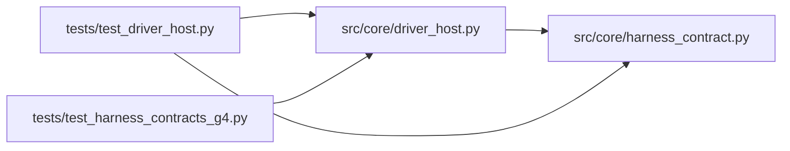

# driver_host Module

**Path:** `src/core/driver_host.py`

## Description

Managed process-driver host: custom drivers under qualified isolation.

A custom driver is an external program speaking a versioned JSONL
event/proposal transport on stdout. The host launches it in the qualified
isolation context — explicit environment, server-derived workspace,
rendered instruction artifacts, and a run-scoped credential — supervises
its process group, bounds its output, and normalizes its events.

Authority separation: the driver's ordinary shell activity is never
evaluator execution and never promotion authority. Its proposals are
candidates (model-proposed), its credential cannot carry operator or
approver permissions, and evidence and filesystem policy are enforced by
the host, not granted to the driver.

## Imports

| Source | Symbols |
|--------|---------|
| `__future__` | `annotations` |
| `dataclasses` | `dataclass`, `field` |
| `json` | `json` |
| `os` | `os` |
| `signal` | `signal` |
| `src.core.harness_contract` | `HARNESS_CONTRACT_VERSION`, `HarnessContractError` |
| `subprocess` | `subprocess` |
| `threading` | `threading` |
| `time` | `time` |
| `typing` | `Any`, `Iterator`, `Mapping`, `Optional` |

## Local dependency map

<!-- Auto-generated local dependency summary. Do not edit by hand. -->

### Internal neighbors

| Direction | Module |
|---|---|
| Inbound | [test_driver_host](../modules/test_driver_host.md) |
| Inbound | [test_harness_contracts_g4](../modules/test_harness_contracts_g4.md) |
| Outbound | [harness_contract](../modules/harness_contract.md) |

## Classes

| Class | Line | Bases | Description |
|-------|------|-------|-------------|
| [DriverHostConfig](../entities/DriverHostConfig.md) | 54 | — | How one driver process is launched and bounded. |
| [DriverOutcome](../entities/DriverOutcome.md) | 72 | — | The attributed end state of one driver process. |
| [DriverProtocolError](../entities/DriverProtocolError.md) | 84 | `HarnessContractError` | The driver's transport violated the documented protocol. |
| [_EventReader](../entities/EventReader.md) | 88 | `threading.Thread` | Bounded stdout reader: normalizes JSONL, enforces size and queue |
| [DriverHost](../entities/DriverHost.md) | 147 | — | Supervises one custom driver process through the JSONL transport. |
