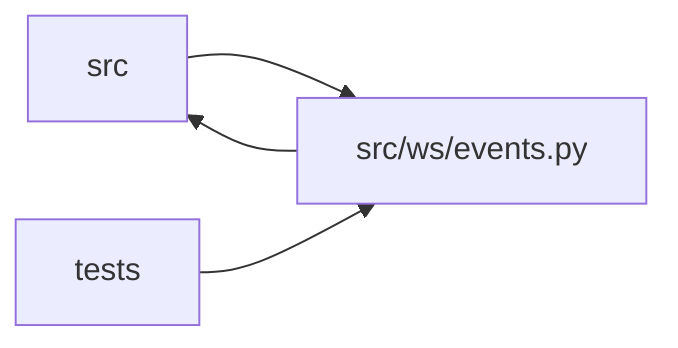

# events Module

**Path:** `src/ws/events.py`

## Description

WebSocket broadcast manager for real-time experiment events.

## Imports

| Source | Symbols |
|--------|---------|
| `__future__` | `annotations` |
| `asyncio` | `asyncio` |
| `fastapi` | `WebSocket` |
| `json` | `json` |
| `logging` | `logging` |
| `src.core.legacy_alias` | `model_type_to_skill_id` |
| `typing` | `Any`, `Dict`, `Set` |

## Local dependency map

<!-- Auto-generated local dependency summary. Do not edit by hand. -->

> Module-level dependencies exceed the generated-diagram limits, so the diagram and table below group them by top-level package. Counts report the number of module neighbors in each package.

### Internal neighbors

| Direction | Module |
|---|---|
| Inbound | `src` (5) |
| Inbound | `tests` (7) |
| Outbound | `src` (1) |

### External packages

| Language | Used packages | Undeclared packages |
|---|---:|---:|
| python | 1 | 1 |

> All 13 module neighbor(s) are summarized by package because the module-level view exceeds the 12-node limit.

## Classes

| Class | Line | Bases | Description |
|-------|------|-------|-------------|
| [EventBroadcaster](../entities/EventBroadcaster.md) | 68 | — | Manages WebSocket client connections and broadcasts events. |

## Functions

| Function | Signature | Decorators | Description |
|----------|-----------|------------|-------------|
| `_enrich_event` | `(event: Any) -> Any` | — | P3-018: enrich a WebSocket event payload with canonical skill fields. |
