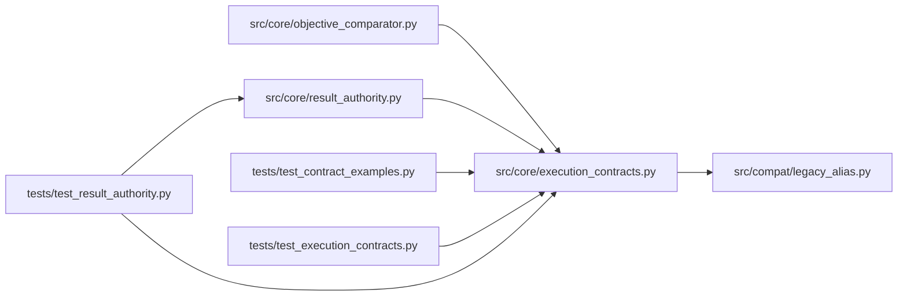

# execution_contracts Module

**Path:** `src/core/execution_contracts.py`

## Description

Versioned research and execution contracts.

Authoritative Pydantic v2 value contracts for the universal research control
plane. They define *what* crosses the kernel boundary — run specifications,
execution requests, candidate and observation identity, evaluator-owned
verified results, objective policy, and capability descriptors — as plain
JSON-serializable value types shared by every integration direction.

Contract rules:

* Every top-level contract carries a ``schema_version`` naming its contract
  family (``research_<name>.v1``); an unknown version fails with an explicit
  error instead of degrading silently.
* Kernel contracts never embed harness SDK types. No provider clients,
  message classes, or vendor payloads appear here; harness-specific settings
  travel as scalar ``effective_config`` entries only.
* Credentials never appear as values. Contracts carry :class:`SecretReference`
  records, or the ``secret://<name>`` wire form inside parameter maps, and
  resolution to real values happens outside these contracts.
* Mutable candidate data stays outside resolved contracts: run specifications
  bind candidates by content digest (:class:`CandidateIdentity`), never by an
  inline payload.

Input layers resolve deterministically (see :func:`resolve_run_inputs`):
explicit run inputs, then skill defaults, then harness preferences, then
system defaults — with operator constraints bounding every step. Harness
preferences fill remaining gaps and can never widen authority.

Compatibility with pre-contract session artifacts and start-request shapes is
explicit: :data:`LEGACY_COMPATIBILITY` classifies each legacy surface as
preserved or rejected-incomplete, and the legacy readers raise
:class:`ContractMigrationError` when a rejected feature is actually requested.
Nothing the mapping classifies as preserved is silently dropped.

## Imports

| Source | Symbols |
|--------|---------|
| `__future__` | `annotations` |
| `hashlib` | `hashlib` |
| `json` | `json` |
| `pydantic` | `BaseModel`, `ConfigDict`, `Field`, `field_validator`, `model_validator` |
| `re` | `re` |
| `src.compat.legacy_alias` | `model_type_to_skill_id` |
| `typing` | `Any`, `ClassVar`, `Literal`, `Mapping`, `Optional` |

## Local dependency map

<!-- Auto-generated local dependency summary. Do not edit by hand. -->

### Internal neighbors

| Direction | Module |
|---|---|
| Inbound | [objective_comparator](../modules/objective_comparator.md) |
| Inbound | [result_authority](../modules/result_authority.md) |
| Inbound | [test_contract_examples](../modules/test_contract_examples.md) |
| Inbound | [test_execution_contracts](../modules/test_execution_contracts.md) |
| Inbound | [test_result_authority](../modules/test_result_authority.md) |
| Outbound | [compat_legacy_alias](../modules/compat_legacy_alias.md) |

### External packages

| Language | Used packages | Undeclared packages |
|---|---:|---:|
| python | 1 | 0 |

## Classes

| Class | Kind | Line | Bases / Target | Description |
|-------|------|------|----------------|-------------|
| [VersionedContract](../entities/VersionedContract.md) | Pydantic model | 75 | `BaseModel` | Base for top-level contracts: pins ``schema_version`` to its family. |
| [ContractError](../entities/ContractError.md) | Class | 103 | `ValueError` | Base error for contract validation and resolution failures. |
| [UnsupportedCapabilityError](../entities/execution_contracts_UnsupportedCapabilityError.md) | Class | 107 | `ContractError` | Raised before work starts when a capability is unknown or unsupported. |
| [ContractMigrationError](../entities/ContractMigrationError.md) | Class | 115 | `ContractError` | Raised when a legacy payload requests a rejected incomplete feature. |
| [SecretReference](../entities/SecretReference.md) | Pydantic model | 144 | `BaseModel` | A named reference to a credential; never the credential itself. |
| [ArtifactRef](../entities/ArtifactRef.md) | Pydantic model | 230 | `BaseModel` | An immutable artifact location bound by content digest. |
| [CandidateIdentity](../entities/CandidateIdentity.md) | Pydantic model | 245 | `VersionedContract` | Immutable identity of a proposed candidate. |
| [CandidateData](../entities/CandidateData.md) | Pydantic model | 269 | `BaseModel` | The mutable candidate payload — deliberately outside run contracts. |
| [ScorerRef](../entities/ScorerRef.md) | Pydantic model | 289 | `BaseModel` | Identity of the scorer that produced an observation. |
| [ObservationIdentity](../entities/ObservationIdentity.md) | Pydantic model | 304 | `VersionedContract` | Identity of one measured observation of a candidate. |
| [ObjectiveDirection](../entities/ObjectiveDirection.md) | Type alias | 357 | `Literal['minimize', 'maximize']` | — |
| [ObjectiveGoal](../entities/ObjectiveGoal.md) | Type alias | 358 | `Literal['optimize', 'satisfice']` | — |
| [MetricConstraint](../entities/MetricConstraint.md) | Pydantic model | 361 | `BaseModel` | A guardrail threshold an eligible result must satisfy. |
| [ObjectivePolicy](../entities/ObjectivePolicy.md) | Pydantic model | 372 | `VersionedContract` | What counts as better, and what must hold for a result to be eligible. |
| [IntegrationDirection](../entities/IntegrationDirection.md) | Type alias | 414 | `Literal['managed', 'attached']` | — |
| [CapabilityDescriptor](../entities/CapabilityDescriptor.md) | Pydantic model | 446 | `VersionedContract` | What a harness/driver can do — with explicit gaps, never silent ones. |
| [IsolationBoundary](../entities/IsolationBoundary.md) | Pydantic model | 516 | `BaseModel` | Declared enforcement boundary for untrusted execution. |
| [FailureRecord](../entities/FailureRecord.md) | Pydantic model | 571 | `BaseModel` | Structured failure detail for an attempt that produced no metrics. |
| [ResultReceipt](../entities/ResultReceipt.md) | Pydantic model | 582 | `BaseModel` | Replay protection and ownership for a result envelope. |
| [VerifiedResult](../entities/VerifiedResult.md) | Pydantic model | 604 | `VersionedContract` | An evaluator-owned measurement of one candidate in one context. |
| [WorkspaceBounds](../entities/WorkspaceBounds.md) | Pydantic model | 671 | `BaseModel` | Where an attempt may write and what it may only read. |
| [NetworkPolicy](../entities/NetworkPolicy.md) | Pydantic model | 680 | `BaseModel` | Network authority for one attempt; deny is the default posture. |
| [ResourceLimits](../entities/ResourceLimits.md) | Pydantic model | 695 | `BaseModel` | OS-enforced resource ceilings for one attempt. |
| [ExecutionRequest](../entities/execution_contracts_ExecutionRequest.md) | Pydantic model | 705 | `VersionedContract` | One approved attempt: what the experiment executor may execute. |
| [SkillPackageRef](../entities/SkillPackageRef.md) | Pydantic model | 756 | `BaseModel` | The exact skill package a run executes. |
| [HarnessConfig](../entities/HarnessConfig.md) | Pydantic model | 771 | `BaseModel` | Harness identity and effective configuration. |
| [EnvironmentIdentity](../entities/EnvironmentIdentity.md) | Pydantic model | 786 | `BaseModel` | Pinned execution environment: image or dependency-lock digest. |
| [BudgetDimensions](../entities/BudgetDimensions.md) | Pydantic model | 810 | `BaseModel` | Spend ceilings for a run; every dimension is explicit. |
| [RunInputs](../entities/RunInputs.md) | Pydantic model | 821 | `BaseModel` | Pinned input identities: what the run evaluates against. |
| [RunLineage](../entities/RunLineage.md) | Pydantic model | 844 | `BaseModel` | Continuation provenance: where this run came from and how to resume. |
| [RunSpec](../entities/RunSpec.md) | Pydantic model | 854 | `VersionedContract` | The persisted, fully resolved run specification. |
| [OperatorConstraints](../entities/OperatorConstraints.md) | Pydantic model | 958 | `BaseModel` | Authority bounds. Every resolved value falls inside these limits. |
| [SkillDefaults](../entities/SkillDefaults.md) | Pydantic model | 985 | `BaseModel` | Defaults declared by the skill package (domain behavior). |
| [HarnessPreferences](../entities/HarnessPreferences.md) | Pydantic model | 995 | `BaseModel` | Harness-level convenience defaults. Advisory only. |
| [ResolutionRecord](../entities/ResolutionRecord.md) | Pydantic model | 1010 | `BaseModel` | Provenance of one resolved value — nothing resolves silently. |
| [ResolvedRunInputs](../entities/ResolvedRunInputs.md) | Pydantic model | 1022 | `BaseModel` | Deterministically resolved inputs with per-field provenance. |
| [LegacyFieldCompat](../entities/LegacyFieldCompat.md) | Pydantic model | 1163 | `BaseModel` | One legacy surface's disposition under the v1 contracts. |
| [LegacyRunInputs](../entities/LegacyRunInputs.md) | Pydantic model | 1285 | `VersionedContract` | What a legacy payload migrates into: identity, parameters, budget. |

## Functions

| Function | Signature | Decorators | Description |
|----------|-----------|------------|-------------|
| `is_secret_reference` | `(value: Any) -> bool` | — | Whether ``value`` is a secret reference wire form (not a raw secret). |
| `reject_raw_secret_parameters` | `(parameters: Mapping[str, Any], where: str) -> None` | — | Reject credential-shaped parameter keys that hold raw values. |
| `validate_secret_list` | `(secrets: list[SecretReference], integration: str) -> None` | — | Reject duplicate names and authority-widening roles for attached runs. |
| `canonical_digest` | `(payload: Mapping[str, Any]) -> str` | — | Content digest of a mapping under canonical JSON encoding. |
| `_check_digest` | `(value: str) -> str` | — | — |
| `objective_policy_from_skill_metric` | `(*, metric_field: str, direction: Literal['higher_is_better', 'lower_is_better'], goal: ObjectiveGoal = 'optimize') -> ObjectivePolicy` | — | Map a skill manifest metric declaration to its objective policy. |
| `ensure_minimum_capabilities` | `(descriptor: CapabilityDescriptor, *, required: frozenset[str] = MINIMUM_SUPPORTED_CAPABILITIES) -> None` | — | Fail before work starts when required capabilities are unavailable. |
| `ensure_capabilities_allowed` | `(descriptor: CapabilityDescriptor, *, allowed: frozenset[str]) -> None` | — | Fail when a descriptor claims capabilities beyond the allowed set. |
| `ensure_isolation_boundary` | `(boundary: IsolationBoundary) -> None` | — | Reject any boundary weaker than the qualified OS-enforced one. |
| `ensure_request_matches_run_spec` | `(request: 'ExecutionRequest', spec: RunSpec) -> None` | — | Verify an execution request is bound to exactly this run specification. |
| `_chain_pick` | `(field: str, *, explicit: Mapping[str, Any], skill_defaults: Mapping[str, Any], preferences: Mapping[str, Any], system_defaults: Mapping[str, Any]) -> tuple[Any, str]` | — | Resolve one field through the precedence chain (no bounding yet). |
| `resolve_run_inputs` | `(*, operator: OperatorConstraints, explicit: Optional[Mapping[str, Any]] = None, skill_defaults: Optional[SkillDefaults] = None, harness_preferences: Optional[HarnessPreferences] = None, system_defaults: Optional[Mapping[str, Any]] = None) -> ResolvedRunInputs` | — | Resolve run inputs with deterministic precedence and hard bounds. |
| `_is_requested` | `(value: Any) -> bool` | — | Whether a legacy payload actually requests a feature (non-empty). |
| `_check_rejected_fields` | `(payload: Mapping[str, Any]) -> list[str]` | — | Raise on requested rejected features; return absent tolerated ones. |
| `_require_identity` | `(payload: Mapping[str, Any]) -> tuple[str, str, str, list[str]]` | — | Resolve (skill_id, subject_id, variant) plus consumed legacy fields. |
| `read_legacy_session_manifest` | `(payload: Mapping[str, Any]) -> LegacyRunInputs` | — | Migrate a serialized session manifest (v1-v3) into contract inputs. |
| `read_legacy_start_request` | `(payload: Mapping[str, Any]) -> LegacyRunInputs` | — | Migrate a legacy start-request shape into contract inputs. |
