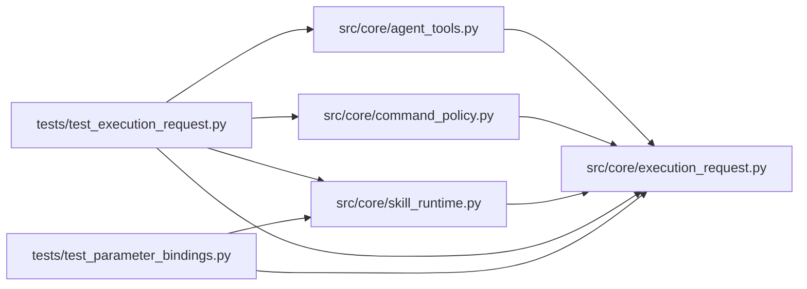

# execution_request Module

**Path:** `src/core/execution_request.py`

## Description

One resolved execution request shared by policy and subprocesses.

F06: the command policy used to validate a bare config filename against the
session directory while the governed subprocess ran with the shared root as
its working directory and the pre-run snapshot resolved the same argument
with yet another rule set. This module resolves executable, typed argv,
fixed arguments, CWD, inputs, outputs, and timeout ONCE into one immutable
:class:`ExecutionRequest`; authorization, pre-run snapshots, sequential and
parallel execution, and result lookup all consume that request instead of
re-deriving paths from the raw command string.

Also home to the template-shape contract: live and demo command templates
must be plain argv forms. A shell-dependent or ambiguous template is
rejected with a migration diagnostic instead of being silently interpreted
under shell rules the governed runner does not apply.

## Imports

| Source | Symbols |
|--------|---------|
| `__future__` | `annotations` |
| `dataclasses` | `dataclass` |
| `os` | `os` |
| `pathlib` | `Path` |
| `re` | `re` |
| `shlex` | `shlex` |
| `typing` | `Any`, `Iterable`, `Mapping`, `Optional`, `Sequence` |

## Local dependency map

<!-- Auto-generated local dependency summary. Do not edit by hand. -->

### Internal neighbors

| Direction | Module |
|---|---|
| Inbound | [agent_tools](../modules/agent_tools.md) |
| Inbound | [command_policy](../modules/command_policy.md) |
| Inbound | [skill_runtime](../modules/skill_runtime.md) |
| Inbound | [test_execution_request](../modules/test_execution_request.md) |
| Inbound | [test_parameter_bindings](../modules/test_parameter_bindings.md) |

## Classes

| Class | Line | Bases | Description |
|-------|------|-------|-------------|
| [ExecutionRequest](../entities/execution_request_ExecutionRequest.md) | 87 | — | The immutable, typed result of resolving one execution request. |
| [_ParsedItem](../entities/ParsedItem.md) | 150 | — | One ordered argv item: a flag with its normalized value, or a positional. |

## Functions

| Function | Signature | Decorators | Description |
|----------|-----------|------------|-------------|
| `template_migration_reason` | `(template: str, *, allowed_placeholders: Iterable[str] = TEMPLATE_PLACEHOLDERS) -> Optional[str]` | — | Return why ``template`` cannot resolve safely, else ``None``. |
| `_is_negative_number` | `(token: str) -> bool` | — | — |
| `_is_flag` | `(token: str) -> bool` | — | — |
| `_parse_arguments` | `(tokens: Sequence[str]) -> tuple[list[_ParsedItem], Optional[str]]` | — | Normalize argument spellings into ordered typed items. |
| `_resolve_path_value` | `(raw: str, *, workspace_root: str, workdir: str) -> str` | — | Resolve one path-typed argument exactly once. |
| `_shell_reason` | `(command: str, argv: Iterable[str]) -> Optional[str]` | — | — |
| `_secret_reason` | `(argv: Iterable[str]) -> Optional[str]` | — | — |
| `_pinned_interpreter_path` | `(workspace_root: str) -> Optional[str]` | — | The workspace-venv interpreter binding the subprocess is pinned to. |
| `_strip_legacy_cd` | `(argv: list[str], workspace_root: str) -> list[str]` | — | — |
| `resolve_execution_request` | `(command: str, *, workspace_root: str, session_workspace: Optional[str], workdir: Optional[str] = None, policy_extension: Optional[Mapping[str, Any]] = None, access: Any = None, timeout_s: int = 7200) -> tuple[Optional[ExecutionRequest], Optional[str]]` | — | Resolve one command into an immutable :class:`ExecutionRequest`. |
| `_python_script_name` | `(raw: str, workspace_root: str) -> str` | — | Normalize a script argument to its workspace-relative declared name. |
| `_resolve_python` | `(argv: list[str], *, workspace_root: str, attempt_root: str, ext: Mapping[str, Any], config_flag: str, output_files: Sequence[str], timeout_s: int) -> tuple[Optional[ExecutionRequest], Optional[str]]` | — | — |
| `_resolve_builtin` | `(argv: list[str], *, session_workspace: Optional[str], attempt_root: str, timeout_s: int, access: Any) -> tuple[Optional[ExecutionRequest], Optional[str]]` | — | Resolve the fixed ``cp``/``cat`` workspace-file bindings. |
