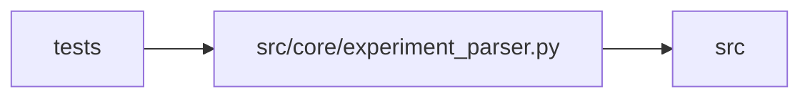

# experiment_parser Module

**Path:** `src/core/experiment_parser.py`

## Description

Parse prepare.py stdout output into structured metrics.

The ``---`` delimited KV-block parsing (``parse_prepare_output``) and the
``ITERATION_RESULT:`` JSON-line scanning (``parse_iteration_marker``) now live
behind the ``OutputParser`` protocol (ARC-011 P1-010..012) in
``src/core/output_parser.py`` (``DelimitedKVParser`` / ``JSONMarkerParser``).
This module keeps the four historical module-level functions as **thin facades**
over the new classes so:

* the parity engine (``tests/parity/_engine.py``) — which dispatches by string
  function name and imports ``from src.core.experiment_parser import ...`` —
  keeps resolving without a fixture re-capture (the X-002 suite is append-only
  within a phase);
* ``parse_prepare_output`` keeps returning an ``IterationMetrics`` (callers and
  the parity engine call ``.to_dict()`` on it), reconstructed from the flat
  dict the new ``DelimitedKVParser`` produces;
* ``is_hpo_study_output`` / ``parse_hpo_study_output`` stay here (they are
  HPO-specific and not part of the ``OutputParser`` surface); the
  ``HpoTrialResult`` / ``HpoStudyResult`` dataclasses and the ``_KV_PATTERN``
  they share stay here too.

``IterationMetrics`` / ``FAILURE_STATUSES`` are re-exported here for back-compat.
Mirrors the P1-007 ``results_store.py`` re-export shim pattern.

## Imports

| Source | Symbols |
|--------|---------|
| `__future__` | `annotations` |
| `dataclasses` | `dataclass`, `field` |
| `json` | `json` |
| `logging` | `logging` |
| `re` | `re` |
| `src.core.output_parser` | `FAILURE_STATUSES`, `DelimitedKVParser`, `JSONMarkerParser` |
| `typing` | `Any`, `Dict`, `List`, `Optional` |

## Local dependency map

<!-- Auto-generated local dependency summary. Do not edit by hand. -->

> Module-level dependencies exceed the generated-diagram limits, so the diagram and table below group them by top-level package. Counts report the number of module neighbors in each package.

### Internal neighbors

| Direction | Module |
|---|---|
| Inbound | `tests` (12) |
| Outbound | `src` (1) |

> All 13 module neighbor(s) are summarized by package because the module-level view exceeds the 12-node limit.

## Classes

| Class | Line | Bases | Description |
|-------|------|-------|-------------|
| [IterationMetrics](../entities/IterationMetrics.md) | 48 | — | Parsed metrics from a single prepare.py run. |
| [HpoTrialResult](../entities/HpoTrialResult.md) | 74 | — | A single trial from an HPO study. |
| [HpoStudyResult](../entities/HpoStudyResult.md) | 85 | — | Parsed HPO study output from prepare.py --hpo mode. |

## Functions

| Function | Signature | Decorators | Description |
|----------|-----------|------------|-------------|
| `parse_prepare_output` | `(stdout: str) -> IterationMetrics` | — | Parse the --- delimited key-value block from prepare.py stdout. |
| `parse_iteration_marker` | `(text: str) -> Optional[Dict[str, Any]]` | — | Parse an ITERATION_RESULT: JSON line from agent output. |
| `is_hpo_study_output` | `(stdout: str) -> bool` | — | Quick check whether stdout contains an HPO study --- block. |
| `parse_hpo_study_output` | `(stdout: str) -> Optional[HpoStudyResult]` | — | Parse the --- delimited HPO study block from prepare.py --hpo output. |
