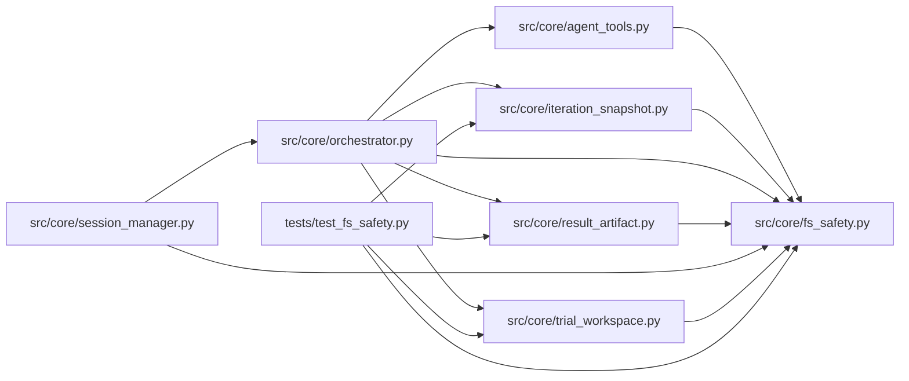

# fs_safety Module

**Path:** `src/core/fs_safety.py`

## Description

Descriptor-relative, no-follow filesystem primitives.

Sensitive writes in this service land in trees whose *contents* are
candidate-influenced (session workspaces, trial staging, server snapshot
directories). Resolve-then-open checks leave a check/use race: a path
component swapped for a symlink between the check and the open redirects the
write outside the authorized root. These helpers close that race on the
qualified Linux target by pinning every path component with a file
descriptor and refusing to follow links at any level.

Link policy (defined here; enforced for writes, imports, and staging):

* **Writes** never follow links. A symlink leaf is denied independently of
  whether its target exists (a dangling link is denied exactly like a link
  to an existing file); symlink parent components are denied; a leaf with
  multiple hard links is denied as an ambiguous alias for a shared file.
  Replacement is atomic (temp file + ``os.replace`` in the pinned parent),
  so a concurrent rename/link swap cannot redirect the write: a rename
  replaces directory entries and never follows links.
* **Imports and staged inputs** (result collection, trial staging) copy
  only regular files with a single hard link, opened ``O_NOFOLLOW``.
  Symlinked, hardlinked, and special entries are skipped or denied with an
  error that names the operation.
* **Plain reads** of candidate files follow links only when the resolved
  target stays inside the authorized roots (enforced by the tool-access
  layer); a leaf with multiple hard links is denied as ambiguous.

The trusted root anchor (a server-derived directory) is opened normally —
its own path may legitimately traverse operator-managed links. Every
component below it is opened ``O_NOFOLLOW | O_DIRECTORY``.

## Imports

| Source | Symbols |
|--------|---------|
| `__future__` | `annotations` |
| `os` | `os` |
| `secrets` | `secrets` |
| `stat` | `stat_mod` |
| `typing` | `Callable`, `Container`, `Optional`, `Sequence` |

## Local dependency map

<!-- Auto-generated local dependency summary. Do not edit by hand. -->

### Internal neighbors

| Direction | Module |
|---|---|
| Inbound | [agent_tools](../modules/agent_tools.md) |
| Inbound | [iteration_snapshot](../modules/iteration_snapshot.md) |
| Inbound | [orchestrator](../modules/orchestrator.md) |
| Inbound | [result_artifact](../modules/result_artifact.md) |
| Inbound | [session_manager](../modules/session_manager.md) |
| Inbound | [trial_workspace](../modules/trial_workspace.md) |
| Inbound | [test_fs_safety](../modules/test_fs_safety.md) |

## Classes

| Class | Kind | Line | Bases / Target | Description |
|-------|------|------|----------------|-------------|
| [SkipCallback](../entities/SkipCallback.md) | Type alias | 45 | `Callable[[str, str], None]` | — |
| [FilesystemSafetyError](../entities/FilesystemSafetyError.md) | Class | 48 | `Exception` | A denied filesystem operation. |

## Functions

| Function | Signature | Decorators | Description |
|----------|-----------|------------|-------------|
| `_relative_components` | `(relative_path: str) -> list[str]` | — | Split a relative path into components; reject escapes and absolutes. |
| `_open_root` | `(root: str, operation: str) -> int` | — | Open the trusted root anchor as a directory descriptor. |
| `_parent_denial_reason` | `(part: str, exc: OSError, *, parent_fd: int) -> str` | — | — |
| `_open_parent_chain` | `(root_fd: int, components: Sequence[str], *, create: bool, operation: str, display: str) -> tuple[int, list[int]]` | — | Walk (and optionally create) parent components without following links. |
| `_close_chain` | `(fds: Sequence[int]) -> None` | — | — |
| `_unlink_quiet` | `(parent_fd: int, name: str) -> None` | — | — |
| `_leaf_denial_reason` | `(leaf: str, st: os.stat_result) -> Optional[str]` | — | Why this leaf cannot be written/imported, or ``None`` when allowed. |
| `_write_at` | `(parent_fd: int, leaf: str, data: bytes, *, display: str) -> None` | — | Replace one leaf in a pinned parent directory, never following links. |
| `safe_write_bytes` | `(root: str, relative_path: str, data: bytes) -> str` | — | Write ``data`` to ``root/relative_path`` with no-follow safety. |
| `safe_write_text` | `(root: str, relative_path: str, text: str, *, encoding: str = 'utf-8') -> str` | — | Text convenience wrapper over :func:`safe_write_bytes`. |
| `read_regular_file` | `(root: str, relative_path: str, *, max_bytes: Optional[int] = None) -> bytes` | — | Read a file for import: regular, single-link, never through a link. |
| `_copy_dir_at` | `(src_fd: int, dst_fd: int, *, on_skip: Optional[SkipCallback], display: str) -> None` | — | Recursively copy a directory's regular, single-link files. |
| `_copy_entry_at` | `(src_fd: int, dst_fd: int, name: str, *, on_skip: Optional[SkipCallback], display: str) -> bool` | — | Copy one entry (and its subtree) without following any link. |
| `copy_tree_regular_files` | `(src_root: str, dst_root: str, *, ignore: Container[str] = (), on_skip: Optional[SkipCallback] = None) -> int` | — | Copy a tree's regular, single-link files; never follow any link. |
