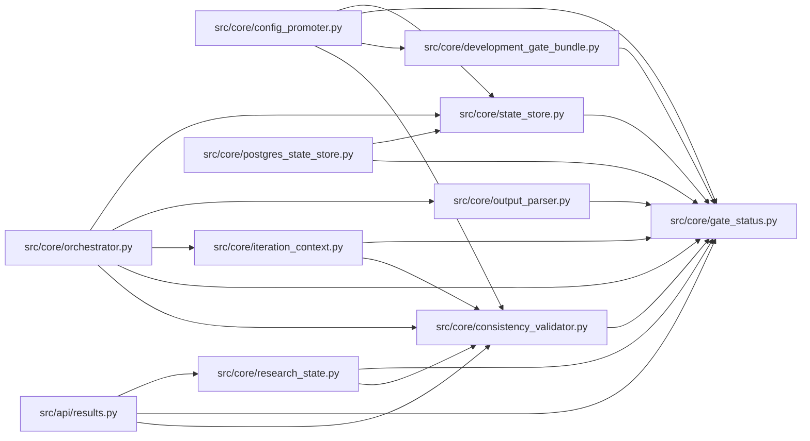

# gate_status Module

**Path:** `src/core/gate_status.py`

## Description

Compatibility helpers for autoresearch gate-status fields.

## Imports

| Source | Symbols |
|--------|---------|
| `__future__` | `annotations` |
| `json` | `json` |
| `logging` | `logging` |
| `typing` | `Any`, `Mapping`, `MutableMapping`, `Optional` |

## Local dependency map

<!-- Auto-generated local dependency summary. Do not edit by hand. -->

### Internal neighbors

| Direction | Module |
|---|---|
| Inbound | [results](../modules/results.md) |
| Inbound | [config_promoter](../modules/config_promoter.md) |
| Inbound | [consistency_validator](../modules/consistency_validator.md) |
| Inbound | [development_gate_bundle](../modules/development_gate_bundle.md) |
| Inbound | [iteration_context](../modules/iteration_context.md) |
| Inbound | [orchestrator](../modules/orchestrator.md) |
| Inbound | [output_parser](../modules/output_parser.md) |
| Inbound | [postgres_state_store](../modules/postgres_state_store.md) |
| Inbound | [research_state](../modules/research_state.md) |
| Inbound | [state_store](../modules/state_store.md) |

## Functions

| Function | Signature | Decorators | Description |
|----------|-----------|------------|-------------|
| `coerce_bool` | `(value: Any, default: bool = False) -> bool` | — | Coerce common marker/API bool encodings to a real bool. |
| `parse_metrics_payload` | `(raw: Any) -> dict[str, Any]` | — | Return a metrics_json payload as a mapping, or an empty dict. |
| `training_gates_passed_from` | `(payload: Mapping[str, Any], *, default: bool = False) -> bool` | — | Read the canonical training-gates flag with legacy fallback. |
| `training_gates_passed_from_iteration` | `(row: Mapping[str, Any], *, default: bool = False) -> bool` | — | Read training gates from an iteration row and its metrics_json. |
| `normalize_training_gate_aliases` | `(payload: MutableMapping[str, Any], *, legacy_value: Any = None, default: bool = False, logger: Optional[logging.Logger] = None, context: str = '') -> bool` | — | Populate canonical and legacy training gate keys on a mutable payload. |
| `consistency_report_passed` | `(report: Any) -> Optional[bool]` | — | Return report.passed when a consistency report mapping is available. |
