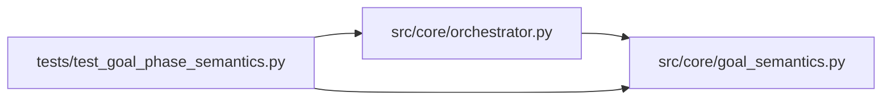

# goal_semantics Module

**Path:** `src/core/goal_semantics.py`

## Description

Declarative optimize/satisfice goal semantics (no expressions, no plugins).

``metric_schema.goal`` selects the decision and outcome semantics:

* ``optimize`` — single-winner optimization: decisions run through the one
  objective comparator (keep/improve/discard against the incumbent).
* ``satisfice`` — meet a declared threshold condition, **no single winner**:
  the declared boolean ``satisfice_threshold_field`` is the threshold
  evidence. A satisfied observation is accepted regardless of ranking; an
  unsatisfied one is not a solution; a condition that was never observed is
  **inconclusive** and can never be silently reported as success.

Terminal outcomes keep exhaustion and inconclusive distinct from success:
``goal_satisficed`` is produced only when the declared condition was observed
true on a verified observation. Unknown goal context is rejected, never
silently treated as a different goal.

## Imports

| Source | Symbols |
|--------|---------|
| `__future__` | `annotations` |
| `typing` | `Any`, `Mapping`, `Optional`, `Sequence` |

## Local dependency map

<!-- Auto-generated local dependency summary. Do not edit by hand. -->

### Internal neighbors

| Direction | Module |
|---|---|
| Inbound | [orchestrator](../modules/orchestrator.md) |
| Inbound | [test_goal_phase_semantics](../modules/test_goal_phase_semantics.md) |

## Functions

| Function | Signature | Decorators | Description |
|----------|-----------|------------|-------------|
| `threshold_evidence` | `(metrics: Any, threshold_field: Optional[str]) -> Mapping[str, Any]` | — | The declared threshold evidence from one verified observation. |
| `goal_decision` | `(*, goal: str, metrics: Any = None, threshold_field: Optional[str] = None, gates_passed: bool = False, comparator: Any = None, primary_metric: Optional[float] = None, incumbent: Optional[float] = None) -> str` | — | Explicit goal-aware decision for one verified observation. |
| `goal_outcome` | `(*, goal: str, observations: Sequence[Any], threshold_field: Optional[str] = None) -> Mapping[str, Any]` | — | Terminal outcome summary over verified observations. |
