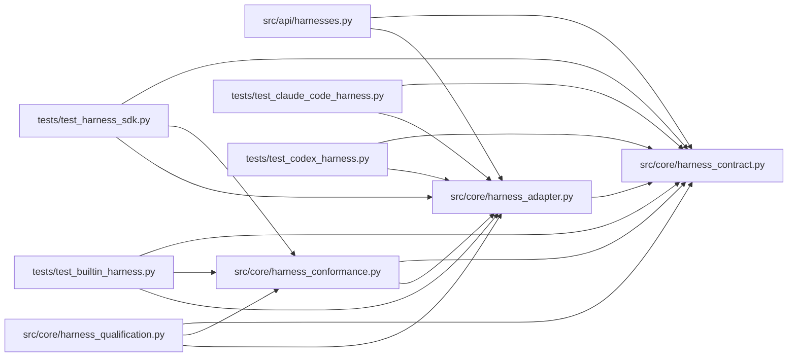

# harness_adapter Module

**Path:** `src/core/harness_adapter.py`

## Description

Harness adapters and registry: identity, capabilities, and run-spec pins.

A harness adapter is registered by name — the kernel holds no per-name
branches. Registration validates the adapter's contract version, identity
coherence, and that every advertised optional capability has a real
implementation. Before launch, skill/operator requirements are validated
against the adapter's advertised capabilities, and the adapter's identity,
version, and permissions resolve into the run spec.

## Imports

| Source | Symbols |
|--------|---------|
| `__future__` | `annotations` |
| `src.core.harness_contract` | `ATTACH_MODES`, `CAPABILITY_PAUSE`, `CAPABILITY_RESUME`, `CAPABILITY_STEERING`, `HARNESS_CONTRACT_VERSION`, `OPTIONAL_CAPABILITIES`, `HarnessContractError`, `HarnessIdentity`, `HarnessProposal`, `HarnessRequirementError`, `HarnessVersionError`, `UnsupportedCapabilityError` |
| `typing` | `Any`, `Iterable`, `Iterator`, `Mapping`, `Optional`, `Protocol`, `runtime_checkable` |

## Local dependency map

<!-- Auto-generated local dependency summary. Do not edit by hand. -->

### Internal neighbors

| Direction | Module |
|---|---|
| Inbound | [harnesses](../modules/harnesses.md) |
| Inbound | [harness_conformance](../modules/harness_conformance.md) |
| Inbound | [harness_qualification](../modules/harness_qualification.md) |
| Inbound | [test_builtin_harness](../modules/test_builtin_harness.md) |
| Inbound | [test_claude_code_harness](../modules/test_claude_code_harness.md) |
| Inbound | [test_codex_harness](../modules/test_codex_harness.md) |
| Inbound | [test_harness_sdk](../modules/test_harness_sdk.md) |
| Outbound | [harness_contract](../modules/harness_contract.md) |

## Classes

| Class | Line | Bases | Description |
|-------|------|-------|-------------|
| [HarnessAdapter](../entities/HarnessAdapter.md) | 31 | `Protocol` | The minimal, versioned harness surface. |
| [HarnessRegistry](../entities/HarnessRegistry.md) | 63 | — | Name → adapter. Registering requires no kernel branch for the name. |

## Functions

| Function | Signature | Decorators | Description |
|----------|-----------|------------|-------------|
| `validate_requirements` | `(adapter: HarnessAdapter, *, required_capabilities: Iterable[str] = (), required_permissions: Iterable[str] = ()) -> None` | — | Pre-launch validation: refuse before any side effect. |
| `request_pause` | `(adapter: HarnessAdapter, handle: str) -> None` | — | Request an optional pause — refused explicitly when unadvertised. |
| `request_resume` | `(adapter: HarnessAdapter, handle: str) -> None` | — | — |
| `request_steer` | `(adapter: HarnessAdapter, handle: str, proposal: Mapping[str, Any]) -> None` | — | — |
| `resolve_harness_spec` | `(adapter: HarnessAdapter, *, required_capabilities: Iterable[str] = (), required_permissions: Iterable[str] = (), attach_mode: Optional[str] = None) -> dict[str, Any]` | — | Resolve identity/version/permissions into a run-spec harness section. |
