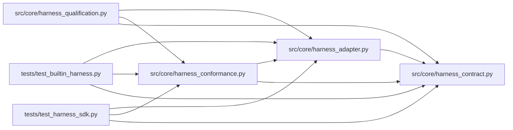

# harness_conformance Module

**Path:** `src/core/harness_conformance.py`

## Description

Reusable harness conformance suite and a deterministic fake adapter.

Integration authors run ``run_conformance`` against their adapter before
connecting it to the kernel. The fake adapter is deterministic and can be
built to violate exactly one rule at a time, so the suite's own checks are
specified by failing examples.

## Imports

| Source | Symbols |
|--------|---------|
| `__future__` | `annotations` |
| `src.core.harness_adapter` | `HarnessAdapter`, `HarnessRegistry`, `request_pause`, `request_resume`, `request_steer` |
| `src.core.harness_contract` | `ATTACH_MODE_CONTINUATION`, `ATTACH_MODE_NATIVE_RESUME`, `CAPABILITY_PAUSE`, `CAPABILITY_RESUME`, `CAPABILITY_STEERING`, `HARNESS_CONTRACT_VERSION`, `OPTIONAL_CAPABILITIES`, `HarnessContractError`, `HarnessLifecycleError`, `HarnessVersionError`, `UnsupportedCapabilityError` |
| `typing` | `Any`, `Iterator`, `Mapping`, `Optional` |

## Local dependency map

<!-- Auto-generated local dependency summary. Do not edit by hand. -->

### Internal neighbors

| Direction | Module |
|---|---|
| Inbound | [harness_qualification](../modules/harness_qualification.md) |
| Inbound | [test_builtin_harness](../modules/test_builtin_harness.md) |
| Inbound | [test_harness_sdk](../modules/test_harness_sdk.md) |
| Outbound | [harness_adapter](../modules/harness_adapter.md) |
| Outbound | [harness_contract](../modules/harness_contract.md) |

## Classes

| Class | Line | Bases | Description |
|-------|------|-------|-------------|
| [FakeHarnessAdapter](../entities/FakeHarnessAdapter.md) | 34 | — | A deterministic harness adapter for specification and testing. |

## Functions

| Function | Signature | Decorators | Description |
|----------|-----------|------------|-------------|
| `run_conformance` | `(adapter: HarnessAdapter, *, start_request: Mapping[str, Any] \| None = None) -> list[str]` | — | Conformance findings for one adapter; empty means conforming. |
