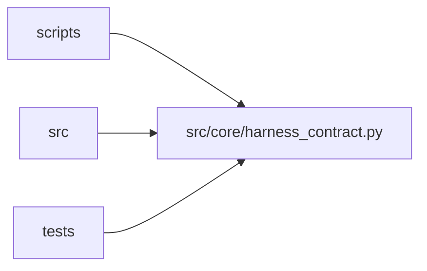

# harness_contract Module

**Path:** `src/core/harness_contract.py`

## Description

Harness contract: the versioned vocabulary between kernel and harnesses.

An agent harness (the built-in loop, or any external agent runtime) drives
the research kernel through this contract. Required operations are minimal
and versioned; optional capabilities are advertised individually and
refuse explicitly when unsupported — a kill is never presented as a
successful pause, and a cross-harness continuation is never claimed as a
native transcript resume.

## Imports

| Source | Symbols |
|--------|---------|
| `__future__` | `annotations` |
| `typing` | `Any`, `Mapping`, `NotRequired`, `Optional`, `TypedDict` |

## Local dependency map

<!-- Auto-generated local dependency summary. Do not edit by hand. -->

> Module-level dependencies exceed the generated-diagram limits, so the diagram and table below group them by top-level package. Counts report the number of module neighbors in each package.

### Internal neighbors

| Direction | Module |
|---|---|
| Inbound | `scripts` (1) |
| Inbound | `src` (8) |
| Inbound | `tests` (5) |

> All 14 module neighbor(s) are summarized by package because the module-level view exceeds the 12-node limit.

## Classes

| Class | Line | Bases | Description |
|-------|------|-------|-------------|
| [HarnessIdentity](../entities/HarnessIdentity.md) | 32 | `TypedDict` | Who the adapter is and what it is allowed to do. |
| [HarnessEvent](../entities/HarnessEvent.md) | 45 | `TypedDict` | One event from a harness's stream; unknown types are tolerated. |
| [HarnessProposal](../entities/HarnessProposal.md) | 56 | `TypedDict` | A proposal carried across the boundary (e.g. a steering proposal). |
| [HarnessErrorRecord](../entities/HarnessErrorRecord.md) | 65 | `TypedDict` | A harness error surfaced as data, with honest retry semantics. |
| [HarnessContractError](../entities/HarnessContractError.md) | 74 | `Exception` | The harness contract was violated or cannot be honored. |
| [HarnessVersionError](../entities/HarnessVersionError.md) | 78 | `HarnessContractError` | The adapter's contract version is incompatible with this SDK. |
| [UnsupportedCapabilityError](../entities/harness_contract_UnsupportedCapabilityError.md) | 82 | `HarnessContractError` | An optional capability was requested but is not advertised. |
| [HarnessRequirementError](../entities/HarnessRequirementError.md) | 98 | `HarnessContractError` | Skill/operator requirements exceed what the adapter provides. |
| [HarnessLifecycleError](../entities/HarnessLifecycleError.md) | 108 | `HarnessContractError` | A lifecycle operation was called out of order or after teardown. |
