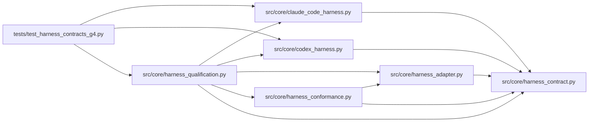

# harness_qualification Module

**Path:** `src/core/harness_qualification.py`

## Description

Harness contract qualification (G4): one shared contract, honest claims.

Every managed and attached surface — the built-in adapter, a custom
process driver, the Codex and Claude Code adapters, and the attached
API/CLI workflow — is qualified against one shared conformance contract
with explicit per-adapter capabilities. Fixture evidence and live-version
evidence are reported separately: a fixture pass never becomes a
compatibility claim, and missing live evidence blocks one.

## Imports

| Source | Symbols |
|--------|---------|
| `__future__` | `annotations` |
| `dataclasses` | `asdict`, `dataclass`, `field` |
| `src.core.claude_code_harness` | `ClaudeRunConfig`, `ClaudeRunConfig` |
| `src.core.codex_harness` | `CodexRunConfig`, `CodexRunConfig` |
| `src.core.harness_adapter` | `HarnessRegistry`, `request_pause`, `request_resume`, `request_steer` |
| `src.core.harness_conformance` | `run_conformance` |
| `src.core.harness_contract` | `HARNESS_CONTRACT_VERSION`, `OPTIONAL_CAPABILITIES`, `HarnessContractError`, `HarnessVersionError`, `UnsupportedCapabilityError` |
| `typing` | `Any`, `Callable`, `Mapping`, `Optional` |

## Local dependency map

<!-- Auto-generated local dependency summary. Do not edit by hand. -->

### Internal neighbors

| Direction | Module |
|---|---|
| Inbound | [test_harness_contracts_g4](../modules/test_harness_contracts_g4.md) |
| Outbound | [claude_code_harness](../modules/claude_code_harness.md) |
| Outbound | [codex_harness](../modules/codex_harness.md) |
| Outbound | [harness_adapter](../modules/harness_adapter.md) |
| Outbound | [harness_conformance](../modules/harness_conformance.md) |
| Outbound | [harness_contract](../modules/harness_contract.md) |

## Classes

| Class | Line | Bases | Description |
|-------|------|-------|-------------|
| [QualificationResult](../entities/QualificationResult.md) | 26 | — | One adapter's qualification: semantics, negatives, and honesty. |

## Functions

| Function | Signature | Decorators | Description |
|----------|-----------|------------|-------------|
| `_negative_unsupported_capabilities` | `(adapter: Any) -> bool` | — | Unadvertised optional capabilities refuse explicitly, never fake. |
| `_negative_cancel` | `(adapter: Any) -> bool` | — | Cancel mid-run is bounded and attributed, never a hang. |
| `_negative_unavailable_executable` | `(adapter: Any) -> bool` | — | A missing executable is an attributed refusal, never a crash. |
| `_negative_version_mismatch` | `(adapter: Any) -> bool` | — | A wrong contract version is refused at registration. |
| `_negative_unknown_usage` | `(normalize: Callable[[Mapping[str, Any]], Any]) -> bool` | — | Unknown usage fields are tolerated and preserved, never zeroed. |
| `_negative_out_of_order_events` | `(normalize: Callable[[Mapping[str, Any]], Any]) -> bool` | — | Duplicate and out-of-order events never crash normalization. |
| `_probe_config` | `(adapter: Any) -> Any` | — | A minimal run config for process-backed adapters. |
| `qualify_adapter` | `(adapter: Any, *, normalize: Optional[Callable[[Mapping[str, Any]], Any]] = None, fixture_evidence: str = 'none', live_evidence: str = 'not_run', permissions_check: Optional[Callable[[], bool]] = None) -> QualificationResult` | — | Qualify one adapter against the shared conformance contract. |
| `supported_matrix` | `(results: list[QualificationResult]) -> dict[str, Any]` | — | The concise supported/unsupported matrix with honest claims. |
| `claim_honesty` | `(result: QualificationResult) -> bool` | — | Fixture success must never become a compatibility claim. |
