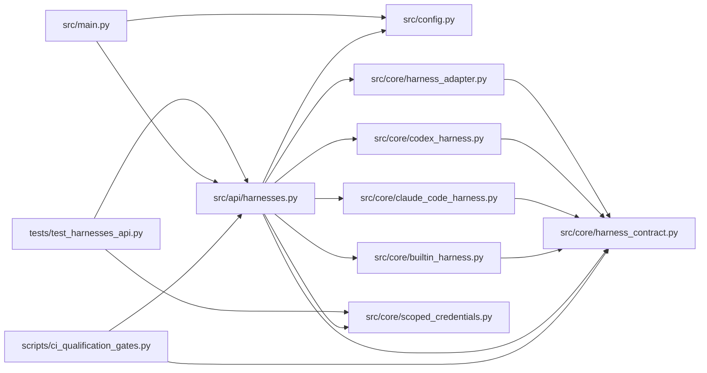

# harnesses Module

**Path:** `src/api/harnesses.py`

## Description

Harness capability descriptors, provenance, and usage context.

The UI renders harness selection, capability/preflight diagnostics, and
run views from these descriptors — never from branches on a harness
name. Unsupported controls carry explicit reasons, unknown cost is
visibly unknown, and lifecycle actions stay consistent with server
authorization (operator or scoped credential).

## Imports

| Source | Symbols |
|--------|---------|
| `__future__` | `annotations` |
| `fastapi` | `APIRouter`, `HTTPException`, `Request` |
| `json` | `json` |
| `src.config` | `secret_value`, `settings` |
| `src.core.builtin_harness` | `BuiltinHarnessAdapter` |
| `src.core.claude_code_harness` | `ClaudeCodeHarnessAdapter` |
| `src.core.codex_harness` | `CodexHarnessAdapter` |
| `src.core.harness_adapter` | `HarnessRegistry` |
| `src.core.harness_contract` | `OPTIONAL_CAPABILITIES` |
| `src.core.scoped_credentials` | `ScopedAuthError`, `verify_scoped_credential` |
| `typing` | `Any`, `Dict`, `List`, `Optional` |

## Local dependency map

<!-- Auto-generated local dependency summary. Do not edit by hand. -->

### Internal neighbors

| Direction | Module |
|---|---|
| Inbound | [ci_qualification_gates](../modules/ci_qualification_gates.md) |
| Inbound | [src_main](../modules/src_main.md) |
| Inbound | [test_harnesses_api](../modules/test_harnesses_api.md) |
| Outbound | [config](../modules/config.md) |
| Outbound | [builtin_harness](../modules/builtin_harness.md) |
| Outbound | [claude_code_harness](../modules/claude_code_harness.md) |
| Outbound | [codex_harness](../modules/codex_harness.md) |
| Outbound | [harness_adapter](../modules/harness_adapter.md) |
| Outbound | [harness_contract](../modules/harness_contract.md) |
| Outbound | [scoped_credentials](../modules/scoped_credentials.md) |

### External packages

| Language | Used packages | Undeclared packages |
|---|---:|---:|
| python | 1 | 1 |

## Functions

| Function | Signature | Decorators | Description |
|----------|-----------|------------|-------------|
| `build_default_registry` | `() -> HarnessRegistry` | — | The harnesses this service hosts — registering needs no name branch. |
| `init` | `(session_manager: Any, store: Any, *, registry: Optional[HarnessRegistry] = None, credential_key: Optional[str] = None) -> None` | — | — |
| `_key` | `() -> str` | — | — |
| `_descriptor` | `(adapter: Any) -> Dict[str, Any]` | — | — |
| `list_harnesses` | *(async)* `() -> Dict[str, Any]` | `@router.get('/harnesses')` | Capability descriptors for every registered harness. |
| `get_harness` | *(async)* `(name: str) -> Dict[str, Any]` | `@router.get('/harnesses/{name}')` | — |
| `_viewer` | *(async)* `(request: Request) -> Dict[str, Any]` | — | The caller's effective permissions: scoped credential or operator. |
| `_lifecycle_actions` | `(descriptor: Dict[str, Any], viewer: Dict[str, Any]) -> List[Dict[str, Any]]` | — | Supported lifecycle actions: capability- and permission-aware. |
| `research_harness_context` | *(async)* `(research_id: str, request: Request) -> Dict[str, Any]` | `@router.get('/research/{research_id}/harness-context')` | Run-bound view: harness, evidence authority, usage quality, resume. |
