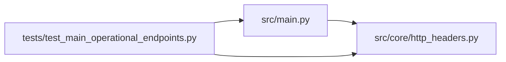

# http_headers Module

**Path:** `src/core/http_headers.py`

## Description

Request-header binding for the autoresearch API.

Normalizes the ``X-Request-ID`` correlation header: caller-supplied values are
echoed and missing values are auto-generated so every request carries a stable
identifier for logs and audit events. Bound values are exposed on
``connection.state.request_headers`` for downstream consumers.

## Imports

| Source | Symbols |
|--------|---------|
| `__future__` | `annotations` |
| `dataclasses` | `dataclass` |
| `fastapi` | `APIRouter`, `Depends`, `FastAPI`, `Header` |
| `functools` | `wraps` |
| `starlette.requests` | `HTTPConnection` |
| `typing` | `Annotated` |
| `uuid` | `uuid4` |

## Local dependency map

<!-- Auto-generated local dependency summary. Do not edit by hand. -->

### Internal neighbors

| Direction | Module |
|---|---|
| Inbound | [src_main](../modules/src_main.md) |
| Inbound | [test_main_operational_endpoints](../modules/test_main_operational_endpoints.md) |

### External packages

| Language | Used packages | Undeclared packages |
|---|---:|---:|
| python | 2 | 2 |

## Classes

| Class | Kind | Line | Bases / Target | Description |
|-------|------|------|----------------|-------------|
| [RequestIdHeaderParam](../entities/RequestIdHeaderParam.md) | Type alias | 21 | `Annotated[str \| None, Header(alias=REQUEST_ID_HEADER, description='Correlation identifier; auto-generated UUID4 when missing.')]` | — |
| [RequestHeaders](../entities/RequestHeaders.md) | Class | 31 | — | Normalized inbound request headers. |

## Functions

| Function | Signature | Decorators | Description |
|----------|-----------|------------|-------------|
| `bind_request_headers` | *(async)* `(connection: HTTPConnection, request_id: RequestIdHeaderParam = None) -> RequestHeaders` | — | Bind normalized request headers to the connection state. |
| `_has_request_header_dependency` | `(dependencies: list) -> bool` | — | — |
| `ensure_app_request_headers` | `(app: FastAPI) -> FastAPI` | — | Ensure every route binds normalized request headers. |
