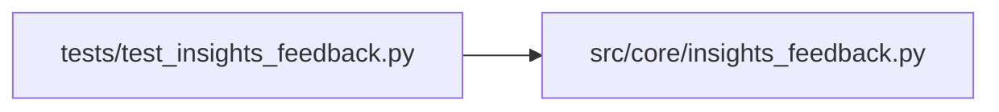

# insights_feedback Module

**Path:** `src/core/insights_feedback.py`

## Description

Insights feedback loop (ARC-011 P5-027 / P5-030).

Appends a completed session's structured insights to the skill's
``knowledge/prior_findings/`` corpus as an append-only markdown file. The
``auto_absorb_insights`` manifest flag (P5-028) controls whether the next
session auto-feeds these findings into its system prompt (default off —
insights land on disk regardless, but require operator review before they
shape agent behavior).

Design decisions (P1-007 house style):

* **Append-only.** The file is named with the ``research_id`` for uniqueness;
  re-running with the same session id overwrites the same file (idempotent on
  retry) but never clobbers a different session's findings.
* **No orchestrator import.** This module is a pure helper; the orchestrator
  calls it at session completion with the already-assembled insight summary.
  Keeps the feedback loop testable in isolation.
* **Safe filename derivation.** The ``research_id`` is sanitized to a filename-
  safe form; the subject/variant provide human-readable context.

## Imports

| Source | Symbols |
|--------|---------|
| `__future__` | `annotations` |
| `datetime` | `datetime`, `timezone` |
| `pathlib` | `Path` |
| `re` | `re` |
| `typing` | `Any`, `Optional` |

## Local dependency map

<!-- Auto-generated local dependency summary. Do not edit by hand. -->

### Internal neighbors

| Direction | Module |
|---|---|
| Inbound | [test_insights_feedback](../modules/test_insights_feedback.md) |

## Functions

| Function | Signature | Decorators | Description |
|----------|-----------|------------|-------------|
| `_safe_filename_component` | `(value: str) -> str` | — | Reduce a free-form string to a filename-safe component. |
| `prior_findings_path` | `(skill_dir: Path, *, subject_id: str, variant: str, research_id: str) -> Path` | — | Derive the append-only prior-findings path for one session. |
| `render_findings_markdown` | `(*, skill_id: str, subject_id: str, variant: str, research_id: str, insight_summary: str, primary_metric: Optional[float] = None, metric_name: Optional[str] = None, iterations: int = 0, completed_at: Optional[str] = None, extra: Optional[dict[str, Any]] = None) -> str` | — | Render the markdown body for a prior-findings file (P5-027). |
| `append_findings` | `(skill_dir: Path, *, skill_id: str, subject_id: str, variant: str, research_id: str, insight_summary: str, primary_metric: Optional[float] = None, metric_name: Optional[str] = None, iterations: int = 0, completed_at: Optional[str] = None, extra: Optional[dict[str, Any]] = None) -> Path` | — | Write the session's prior-findings file (P5-027). |
