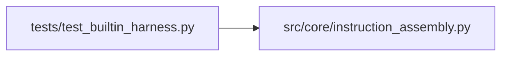

# instruction_assembly Module

**Path:** `src/core/instruction_assembly.py`

## Description

Instruction assembly: common research directives vs harness specifics.

Instructions are product assets with two owners. Common research
instructions are domain-agnostic and harness-free; tool and harness
instructions describe one harness's execution surface and are supplied by
the harness adapter. Workspace instruction files (the built-in harness's
``CLAUDE.md``, another harness's ``AGENTS.md``) are rendered only through
adapters — core behavior never depends on a particular filename or on any
provider's tool-block shape.

## Imports

| Source | Symbols |
|--------|---------|
| `__future__` | `annotations` |
| `typing` | `Iterable`, `Sequence` |

## Local dependency map

<!-- Auto-generated local dependency summary. Do not edit by hand. -->

### Internal neighbors

| Direction | Module |
|---|---|
| Inbound | [test_builtin_harness](../modules/test_builtin_harness.md) |

## Functions

| Function | Signature | Decorators | Description |
|----------|-----------|------------|-------------|
| `harness_tool_instructions` | `(tools: Sequence[tuple[str, str]], *, surface_name: str) -> str` | — | Render one harness's tool instructions as provider-neutral prose. |
| `assemble_instructions` | `(*, common: str = COMMON_RESEARCH_INSTRUCTIONS, harness: str = '', skill_primer: str = '') -> str` | — | Assemble the run's instructions deterministically. |
| `render_workspace_instructions` | `(*, filename: str, common: str = COMMON_RESEARCH_INSTRUCTIONS, harness: str = '') -> tuple[str, str]` | — | Render a workspace instruction file for the harness's chosen name. |
