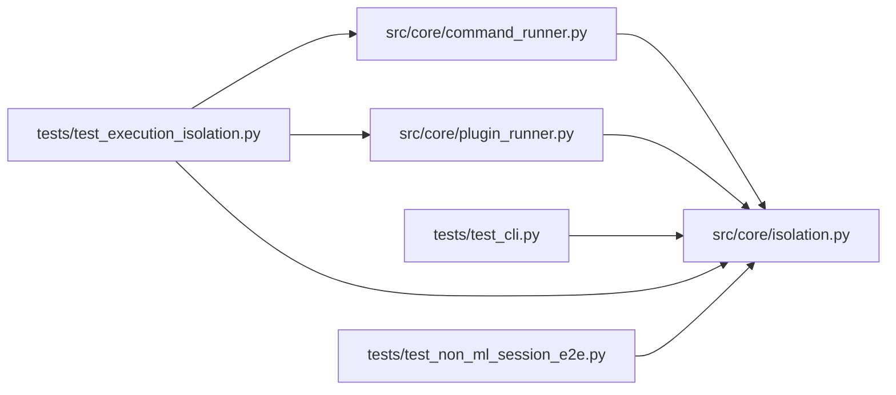

# isolation Module

**Path:** `src/core/isolation.py`

## Description

Enforced process isolation: mounts, identity, and network at the OS boundary.

This module is the universal execution boundary for candidate-controlled
subprocesses. It wraps a command behind an OS-enforced sandbox (the
selected Linux backend) instead of trusting in-process checks: filesystem
writes outside the declared write roots fail at the kernel, network access
is default-deny at the namespace, and every child process inherits the
same policy.

Backend spike (bounded, mount/identity/network/resource probes):

* **Container deployment (first candidate, docker 28.4.0):** enforcement
  demonstrated — ``--read-only`` refused writes at the mount layer,
  ``--user`` changed the process identity, ``--network none`` made all
  destinations unreachable, and resource flags bind through cgroups. It is
  the outer deployment boundary, but it fails the per-execution contract:
  the daemon is not available from inside the deployed service container,
  and mapping the pinned workspace interpreter into an image cannot
  preserve the interpreter pin across environments.
* **bubblewrap 0.11.1 (selected):** the same enforcement demonstrated
  with the exact pinned interpreter — read-only root and read-only
  workspace refused writes (``fs_write: none``), a writable bind
  permitted only workspace writes (``fs_write: workspace``), the shared
  user/mount/pid/net namespace made every destination unreachable and
  contained spawned children, and it runs unprivileged wherever user
  namespaces are permitted.

Network allowlists (``host:port`` egress) are **not enforceable** by
either backend at the OS boundary (namespaces are all-or-nothing without
host firewall authority). Requests for allowed destinations are refused
as unsupported capability requests — never silently widened — and full
allowlist enforcement remains qualification WAITING_EXTERNAL on host
firewall authority.

Trusted local-code mode is an operator policy, separately labeled and
never advertised as sandboxed: see ``TRUSTED_LOCAL_CODE``.

## Imports

| Source | Symbols |
|--------|---------|
| `__future__` | `annotations` |
| `dataclasses` | `dataclass` |
| `os` | `os` |
| `shutil` | `shutil` |
| `subprocess` | `subprocess` |
| `typing` | `Literal`, `Optional`, `Sequence` |

## Local dependency map

<!-- Auto-generated local dependency summary. Do not edit by hand. -->

### Internal neighbors

| Direction | Module |
|---|---|
| Inbound | [command_runner](../modules/command_runner.md) |
| Inbound | [plugin_runner](../modules/plugin_runner.md) |
| Inbound | [test_cli](../modules/test_cli.md) |
| Inbound | [test_execution_isolation](../modules/test_execution_isolation.md) |
| Inbound | [test_non_ml_session_e2e](../modules/test_non_ml_session_e2e.md) |

## Classes

| Class | Line | Bases | Description |
|-------|------|-------|-------------|
| [IsolationError](../entities/IsolationError.md) | 53 | `RuntimeError` | Base class for isolation boundary failures (always fail-closed). |
| [IsolationUnavailableError](../entities/IsolationUnavailableError.md) | 57 | `IsolationError` | Host prerequisites for the isolation backend are missing. |
| [UnsupportedCapabilityError](../entities/isolation_UnsupportedCapabilityError.md) | 61 | `IsolationError` | A capability request the selected backend cannot enforce. |
| [IsolationPolicy](../entities/IsolationPolicy.md) | 66 | — | The declared boundary for one candidate-controlled subprocess. |
| [BwrapBackend](../entities/BwrapBackend.md) | 94 | — | The selected isolation backend (bubblewrap 0.11.1). |

## Functions

| Function | Signature | Decorators | Description |
|----------|-----------|------------|-------------|
| `probe_host` | `(*, bwrap_bin: Optional[str] = None) -> dict[str, object]` | — | Probe the host features the selected backend requires (real checks). |
| `select_backend` | `() -> BwrapBackend` | — | Select the isolation backend or raise :class:`IsolationUnavailableError`. |
| `wrap_command` | `(argv: Sequence[str], *, policy: IsolationPolicy, backend: Optional[BwrapBackend] = None) -> list[str]` | — | Wrap ``argv`` in the isolation boundary (selecting the backend if needed). |
