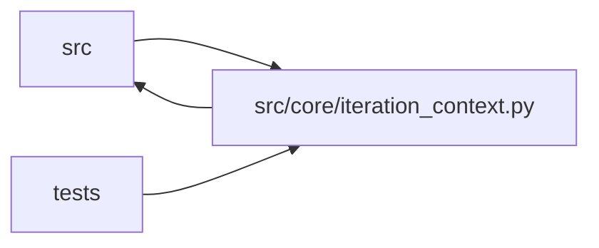

# iteration_context Module

**Path:** `src/core/iteration_context.py`

## Description

Compact iteration context digests for autoresearch agents.

## Imports

| Source | Symbols |
|--------|---------|
| `__future__` | `annotations` |
| `json` | `json` |
| `logging` | `logging` |
| `math` | `math` |
| `src.core.consistency_validator` | `parse_consistency_report` |
| `src.core.gate_status` | `training_gates_passed_from_iteration` |
| `src.core.objective_comparator` | `ObjectiveComparator`, `objective_comparator_for_skill_id`, `select_best_row` |
| `src.core.significance` | `best_config_hash`, `best_other_config_hash`, `samples_from_rows`, `significance_verdict` |
| `src.core.skill_registry` | `default_registry` |
| `typing` | `Any`, `Iterable`, `List`, `Mapping`, `Optional`, `Sequence`, `Tuple` |
| `yaml` | `yaml` |

## Local dependency map

<!-- Auto-generated local dependency summary. Do not edit by hand. -->

> Module-level dependencies exceed the generated-diagram limits, so the diagram and table below group them by top-level package. Counts report the number of module neighbors in each package.

### Internal neighbors

| Direction | Module |
|---|---|
| Inbound | `src` (1) |
| Inbound | `tests` (6) |
| Outbound | `src` (5) |

### External packages

| Language | Used packages | Undeclared packages |
|---|---:|---:|
| python | 1 | 0 |

> All 12 module neighbor(s) are summarized by package because the module-level view exceeds the 12-node limit.

## Functions

| Function | Signature | Decorators | Description |
|----------|-----------|------------|-------------|
| `derive_exploration_markers` | `(model_type: str, current_config: Mapping[str, Any] \| None, baseline_config: Mapping[str, Any] \| None) -> dict[str, Any]` | — | Return phase-advancement markers this iter should emit, derived |
| `_resolve_dotted` | `(config: Mapping[str, Any], key: str) -> Any` | — | Resolve a possibly-dotted knob name against a (possibly nested) config. |
| `build_iteration_context_digest` | `(*, session: Mapping[str, Any], iterations: Iterable[Mapping[str, Any]], hpo_studies: Iterable[Mapping[str, Any]] = (), planned_trials: Iterable[Mapping[str, Any]] = (), phase_state: Optional[Mapping[str, Any]] = None, prior_session_summary: Optional[Iterable[Mapping[str, Any]]] = None, promotion_readiness: Optional[Iterable[Mapping[str, Any]]] = None, max_chars: int = 6000, recent_attempts: int = 5) -> str` | — | Build a deterministic, bounded digest of persisted iteration state. |
| `_significance_line` | `(rows: List[Mapping[str, Any]], session: Mapping[str, Any], *, comparator: 'ObjectiveComparator') -> str` | — | Visibility line for the declared significance/replication policy. |
| `_best_line` | `(iterations: 'Sequence[Mapping[str, Any]]', *, comparator: 'ObjectiveComparator') -> str` | — | — |
| `_attempt_line` | `(row: Mapping[str, Any]) -> str` | — | — |
| `_blockers_line` | `(iterations: List[Mapping[str, Any]]) -> str` | — | — |
| `_duplicate_line` | `(iterations: List[Mapping[str, Any]]) -> str` | — | — |
| `_tried_configs_lines` | `(iterations: List[Mapping[str, Any]]) -> List[str]` | — | Action 5: enumerate the distinct configs already attempted THIS session, |
| `_hpo_line` | `(studies: List[Mapping[str, Any]], trials: List[Mapping[str, Any]]) -> Optional[str]` | — | — |
| `_next_guidance` | `(iterations: List[Mapping[str, Any]]) -> str` | — | — |
| `_prior_session_tried_lines` | `(summary: List[Mapping[str, Any]], *, model_type: str = '') -> List[str]` | — | Render the "Tried in prior sessions" digest block. |
| `_select_representative_clusters` | `(rows: List[Mapping[str, Any]], model_type: str, max_entries: int) -> List[dict]` | — | Group rows into parameter-space clusters and pick a bounded, |
| `_parse_snapshot` | `(config_snapshot: Any) -> Optional[dict]` | — | Parse a YAML config_snapshot once. Returns the dict or None. |
| `_cluster_key` | `(parsed: Optional[dict], model_type: str) -> Optional[Tuple[Any, ...]]` | — | Build a hashable, bucketed cluster key from a parsed config. |
| `_bucket_value` | `(value: Any, width: 'float \| str \| None') -> Any` | — | Bucket a single value for clustering. Lists → tuple, numerics → |
| `_signature_from_parsed` | `(parsed: Optional[dict], model_type: str) -> Optional[str]` | — | Render the ``key=value, …`` signature from an already-parsed config. |
| `_extract_param_signature` | `(config_snapshot: Any, model_type: str) -> Optional[str]` | — | Back-compat wrapper: parse a raw snapshot then render its signature. |
| `_feature_availability_lines` | `(same_session_rows: List[Mapping[str, Any]], prior_summary: List[Mapping[str, Any]]) -> List[str]` | — | Detect persistent server-side feature unavailability across sessions. |
| `_row_blockers` | `(row: Mapping[str, Any]) -> List[str]` | — | — |
| `_parse_mapping` | `(raw: Any) -> dict[str, Any]` | — | — |
| `_unique` | `(values: Iterable[str]) -> List[str]` | — | — |
| `_number` | `(value: Any) -> Optional[float]` | — | — |
| `_fmt` | `(value: Optional[float]) -> str` | — | — |
| `_money` | `(value: Optional[float]) -> str` | — | — |
| `_yes_no` | `(value: Any) -> str` | — | — |
| `_short` | `(value: str, limit: int) -> str` | — | — |
| `_cap_text` | `(text: str, max_chars: int) -> str` | — | — |
