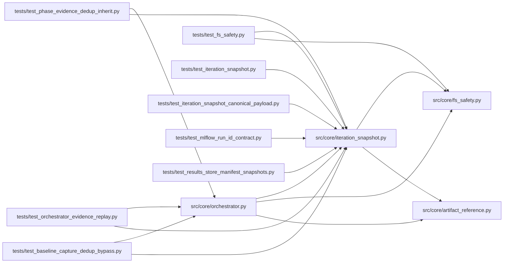

# iteration_snapshot Module

**Path:** `src/core/iteration_snapshot.py`

## Description

Server-owned immutable snapshots for autoresearch iteration attempts.

## Imports

| Source | Symbols |
|--------|---------|
| `__future__` | `annotations` |
| `datetime` | `datetime`, `timezone` |
| `hashlib` | `hashlib` |
| `json` | `json` |
| `os` | `os` |
| `pathlib` | `Path` |
| `platform` | `platform` |
| `shlex` | `shlex` |
| `src.core` | `fs_safety` |
| `src.core.artifact_reference` | `normalize_optional_artifact_ref` |
| `typing` | `Any`, `Dict`, `Mapping`, `Optional` |
| `yaml` | `yaml` |

## Local dependency map

<!-- Auto-generated local dependency summary. Do not edit by hand. -->

### Internal neighbors

| Direction | Module |
|---|---|
| Inbound | [orchestrator](../modules/orchestrator.md) |
| Inbound | [test_baseline_capture_dedup_bypass](../modules/test_baseline_capture_dedup_bypass.md) |
| Inbound | [test_fs_safety](../modules/test_fs_safety.md) |
| Inbound | [test_iteration_snapshot](../modules/test_iteration_snapshot.md) |
| Inbound | [test_iteration_snapshot_canonical_payload](../modules/test_iteration_snapshot_canonical_payload.md) |
| Inbound | [test_mlflow_run_id_contract](../modules/test_mlflow_run_id_contract.md) |
| Inbound | [test_orchestrator_evidence_replay](../modules/test_orchestrator_evidence_replay.md) |
| Inbound | [test_phase_evidence_dedup_inherit](../modules/test_phase_evidence_dedup_inherit.md) |
| Inbound | [test_results_store_manifest_snapshots](../modules/test_results_store_manifest_snapshots.md) |
| Outbound | [artifact_reference](../modules/artifact_reference.md) |
| Outbound | [fs_safety](../modules/fs_safety.md) |

### External packages

| Language | Used packages | Undeclared packages |
|---|---:|---:|
| python | 1 | 0 |

## Functions

| Function | Signature | Decorators | Description |
|----------|-----------|------------|-------------|
| `build_iteration_attempt_snapshot` | `(*, research_id: str, iteration: int, turn: int, command: str, config_snapshot: Any, workspace: str, marker: Optional[Dict[str, Any]] = None) -> Dict[str, Any]` | — | Build a server-owned attempt snapshot for one trial. |
| `canonical_config_hash` | `(config_snapshot: Any) -> Optional[str]` | — | Hash config content after semantic YAML/JSON canonicalization. |
| `canonical_config_payload` | `(config_snapshot: Any) -> Any` | — | Return a stable representation of a config snapshot. |
| `build_trial_identity` | `(*, instrument: str, timeframe: str, model_type: str, command: Optional[str], config_snapshot: Any, quick_mode: bool, marker: Optional[Mapping[str, Any]] = None, source_model_ids: Optional[Mapping[str, Any]] = None) -> Dict[str, Any]` | — | Build a duplicate-detection identity for one planned/training attempt. |
| `trial_identity_hash` | `(identity: Mapping[str, Any]) -> Optional[str]` | — | Return a stable SHA-256 hash for a trial identity. |
| `write_iteration_attempt_snapshot` | `(*, workspace: str, snapshot: Dict[str, Any]) -> str` | — | Persist an attempt snapshot JSON file under the session workspace. |
| `_environment_metadata` | `() -> Dict[str, Any]` | — | — |
| `_sha256_text` | `(value: Any) -> Optional[str]` | — | — |
| `_snapshot_hash` | `(snapshot: Dict[str, Any]) -> str` | — | — |
| `_first_present` | `(container: Dict[str, Any], *keys: str) -> Any` | — | — |
| `_dict_at` | `(container: Mapping[str, Any], key: str) -> Dict[str, Any]` | — | — |
| `_canonicalize` | `(value: Any) -> Any` | — | — |
| `_argv` | `(command: Optional[str]) -> list[str]` | — | — |
| `_command_arg` | `(command: Optional[str], flag: str) -> Optional[str]` | — | — |
| `_resolve_seed` | `(*, command: Optional[str], config_payload: Any, marker: Mapping[str, Any]) -> Any` | — | — |
| `_resolve_validation_mode` | `(*, command: Optional[str], quick_mode: bool, marker: Mapping[str, Any]) -> str` | — | — |
| `_normalize_source_model_ids` | `(source_model_ids: Optional[Mapping[str, Any]]) -> Dict[str, Any]` | — | Keep only the resolved (non-empty) upstream source run-ids under stable keys, |
| `_resolve_data_split_id` | `(config_payload: Any, *, source_model_ids: Optional[Mapping[str, Any]] = None) -> str` | — | — |
| `_first_nested` | `(container: Any, paths: tuple[tuple[str, ...], ...]) -> Any` | — | — |
| `_nested_get` | `(container: Any, path: tuple[str, ...]) -> Any` | — | — |
| `_coerce_scalar` | `(value: str) -> Any` | — | — |
