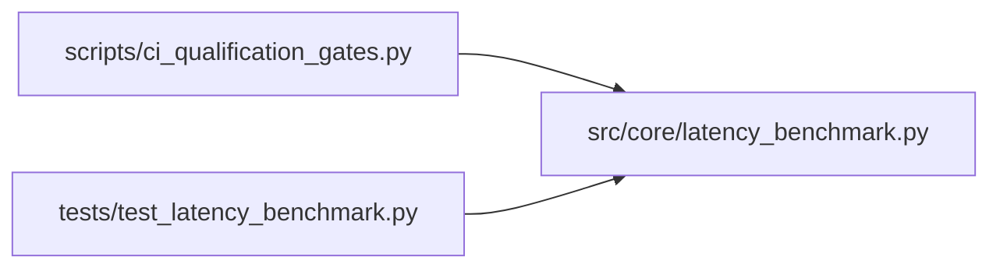

# latency_benchmark Module

**Path:** `src/core/latency_benchmark.py`

## Description

Measured latency minimization over an agent-owned loopback service.

A controlled benchmark: a loopback HTTP service serving a frozen data/
query workload, a request mix frozen before comparison, warmup, a
resource envelope, percentile latency with guardrails, repeated
measurements with uncertainty, and an immutable evaluation-context
identity. A candidate becomes the minimization winner only when its
measured improvement passes guardrails and qualification evidence;
noisy or incomparable samples never win. A simulated (sleep-based)
mode exists only as a separately labeled mode and is never comparable
with measured results. The workload ships as a skill (no core edits)
and every result labels its environment limits.

## Imports

| Source | Symbols |
|--------|---------|
| `__future__` | `annotations` |
| `dataclasses` | `dataclass`, `field` |
| `hashlib` | `hashlib` |
| `http.client` | `http.client` |
| `http.server` | `BaseHTTPRequestHandler`, `ThreadingHTTPServer` |
| `json` | `json` |
| `pathlib` | `Path` |
| `platform` | `platform` |
| `random` | `random` |
| `statistics` | `statistics` |
| `sys` | `sys` |
| `threading` | `threading` |
| `time` | `time` |
| `typing` | `Any`, `Callable`, `Mapping`, `Optional`, `Sequence` |

## Local dependency map

<!-- Auto-generated local dependency summary. Do not edit by hand. -->

### Internal neighbors

| Direction | Module |
|---|---|
| Inbound | [ci_qualification_gates](../modules/ci_qualification_gates.md) |
| Inbound | [test_latency_benchmark](../modules/test_latency_benchmark.md) |

## Classes

| Class | Line | Bases | Description |
|-------|------|-------|-------------|
| [Workload](../entities/Workload.md) | 34 | — | The fixed data/query workload: a dataset and a frozen request mix. |
| [_QueryHandler](../entities/QueryHandler.md) | 105 | `BaseHTTPRequestHandler` | — |
| [LoopbackService](../entities/LoopbackService.md) | 123 | — | The agent-owned loopback HTTP service under measurement. |
| [MeasurementProtocol](../entities/MeasurementProtocol.md) | 156 | — | Frozen before comparison: mix, warmup, repeats, guardrails. |
| [Measurement](../entities/Measurement.md) | 228 | — | One variant's measured result: evidence, not a claim. |
| [MinimizationDecision](../entities/MinimizationDecision.md) | 361 | — | Lower-is-better with guardrails: a winner only on qualified evidence. |
| [MeasurementStore](../entities/MeasurementStore.md) | 464 | — | Storage for measurements: JSONL keyed by context digest + variant. |

## Functions

| Function | Signature | Decorators | Description |
|----------|-----------|------------|-------------|
| `build_workload` | `(*, workload_id: str = 'latency-min-1', size: int = 20000) -> Workload` | — | A frozen workload: a dataset and a request mix decided before runs. |
| `_variant_scan` | `(items: tuple[tuple[str, float], ...], key: str) -> float` | — | — |
| `_variant_index` | `(items: tuple[tuple[str, float], ...], key: str) -> float` | — | — |
| `_variant_rescan` | `(items: tuple[tuple[str, float], ...], key: str) -> float` | — | — |
| `evaluation_context` | `(protocol: MeasurementProtocol, workload: Workload, *, mode: str = MODE_MEASURED) -> dict[str, Any]` | — | Immutable baseline/evaluation-context identity for comparability. |
| `_calibrate` | `(probe: Optional[Callable[[], float]] = None) -> float` | — | A fixed CPU probe: median of three rounds; contention detection. |
| `run_measurement` | `(*, variant_id: str, variant: Callable[[tuple[tuple[str, float], ...], str], float], workload: Workload, protocol: MeasurementProtocol, mode: str = MODE_MEASURED, probe: Optional[Callable[[], float]] = None) -> Measurement` | — | Measure one variant under the frozen protocol. |
| `decide_minimization` | `(baseline: Measurement, candidate: Measurement, protocol: MeasurementProtocol) -> MinimizationDecision` | — | Select a measured improvement only when constraints and evidence pass. |
| `promote_minimized` | `(*, baseline: Measurement, candidate: Measurement, protocol: MeasurementProtocol, store: MeasurementStore) -> dict[str, Any]` | — | Promotion through storage: only a qualified winner is promoted. |
