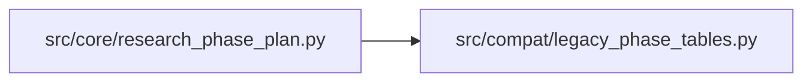

# legacy_phase_tables Module

**Path:** `src/compat/legacy_phase_tables.py`

## Description

Historical trading-skill phase tables (moved to src/compat — P1-2).

The DIRECTION / VOLATILITY / FALLBACK phase plans, the legacy ``model_type``
lookup (``phases_for_model``), the historical RL OOS evidence keys, and the
DM-14 per-phase primary-sweep knob table. Kept verbatim from
``src/core/research_phase_plan.py`` so pre-migration database rows still
render and legacy sessions keep their phase plan; new skills declare their
own ``phase_plan`` in ``SKILL.yaml``. Nothing here may grow new features —
the domain-coupling guard exempts (and thereby documents) this file.

## Imports

| Source | Symbols |
|--------|---------|
| `__future__` | `annotations` |
| `typing` | `Any`, `Dict`, `List`, `Optional` |

## Local dependency map

<!-- Auto-generated local dependency summary. Do not edit by hand. -->

### Internal neighbors

| Direction | Module |
|---|---|
| Inbound | [research_phase_plan](../modules/research_phase_plan.md) |

## Functions

| Function | Signature | Decorators | Description |
|----------|-----------|------------|-------------|
| `phases_for_model` | `(model_type: Optional[str]) -> List[Dict[str, Any]]` | — | Return the canonical phase list for the given model_type. |
