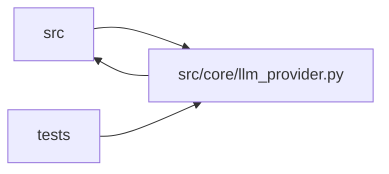

# llm_provider Module

**Path:** `src/core/llm_provider.py`

## Description

``LLMProvider`` protocol + normalized value types + ``AnthropicProvider``
(ARC-011 P1-001 / P1-002).

This module adopts the X-005 LLM-provider normalization spike §4 *verbatim*
(ARC-011 spike §4; this module's protocol docstrings are the record) as the canonical contract every
provider implementation must satisfy: ``messages_create`` (main agentic path),
``complete`` (one-shot insights/Haiku path), an optional ``stream``,
``estimate_cost`` (→ P1-003), ``capabilities`` (→ P4-009 / router P4-010), and
``classify_error`` (→ loop-owned retry, R4).

P1-002 extracts ``AnthropicProvider`` — the 1:1 SDK adapter — into this module.
The orchestrator (P1-002) consumes ``ProviderResponse`` (normalized
``StopReason``/``ContentBlock``/``Usage``) and holds its conversation as
``list[Message]``. The provider translates at the SDK boundary only, so the
Anthropic wire format is byte-identical to pre-refactor and the X-002 parity
suite is preserved.

Design decisions recorded by the spike and baked in here:

* **Anthropic-shaped normalized types** (spike §4 note). ``ToolUseBlock.input``
  is a ``dict`` (Anthropic shape; OpenAI's JSON-string ``function.arguments``
  is parsed by the provider), ``ToolResultBlock`` is the Anthropic tool-result
  block, and ``ToolDef`` matches the ``AGENT_TOOLS`` shape. This keeps
  ``AnthropicProvider`` a 1:1 wrapper and preserves the parity suite.
* **Loop-owned retry (R4 / D-retry).** The protocol exposes
  ``classify_error``; the loop owns backoff + the budget-aware skip
  (``orchestrator.py`` ``_call_llm_with_retry``). ``ErrorClass.transient`` is
  the signal. Retry does NOT live in the provider — the budget-aware skip
  depends on session wall-clock state (``remaining_budget_s``), which is loop
  policy, not provider state.
* **Phase-contract enforcement is loop-level (R5 / §5).** The provider surfaces
  a normalized ``StopReason``; the loop reads ``StopReason.END_TURN`` to trigger
  phase continuation. The defensive invariant *"tool calls present ⇒
  TOOL_USE, regardless of the native finish_reason"* (Gemini can report
  ``STOP`` with function calls present) is the provider's responsibility —
  enforced in ``AnthropicProvider._from_sdk_response``.
* **Not ``@runtime_checkable``.** ``isinstance`` against a ``Protocol`` only
  checks attribute presence (false confidence on signatures). This is a
  typing-time contract; consumers accept it as a typed parameter.

Three places where the spike §4 draft was incomplete (resolved in P1-001, the
only deviations from a literal copy — see inline comments):

1. The draft references ``ContentBlock`` (in ``ProviderResponse.content``) and
   ``StreamDelta`` (in ``stream()``) without defining them.
2. The draft's ``Message{role, content: list[Block]}`` does not match the live
   orchestrator, which builds messages with ``content: str`` (user prompts) and
   ``content: list[block]`` (assistant / tool-result turns).

## Imports

| Source | Symbols |
|--------|---------|
| `__future__` | `annotations` |
| `anthropic` | `anthropic` |
| `collections.abc` | `AsyncIterator` |
| `dataclasses` | `asdict`, `dataclass` |
| `enum` | `Enum` |
| `httpx` | `httpx` |
| `json` | `json` |
| `logging` | `logging` |
| `src.config` | `secret_value`, `settings` |
| `typing` | `Any`, `Optional`, `Protocol` |

## Local dependency map

<!-- Auto-generated local dependency summary. Do not edit by hand. -->

> Module-level dependencies exceed the generated-diagram limits, so the diagram and table below group them by top-level package. Counts report the number of module neighbors in each package.

### Internal neighbors

| Direction | Module |
|---|---|
| Inbound | `src` (5) |
| Inbound | `tests` (13) |
| Outbound | `src` (1) |

### External packages

| Language | Used packages | Undeclared packages |
|---|---:|---:|
| python | 2 | 1 |

> All 19 module neighbor(s) are summarized by package because the module-level view exceeds the 12-node limit.

## Classes

| Class | Kind | Line | Bases / Target | Description |
|-------|------|------|----------------|-------------|
| [StopReason](../entities/StopReason.md) | Enum | 120 | `str`, `Enum` | Normalized reason the model stopped generating (R5-critical). |
| [Usage](../entities/Usage.md) | Class | 145 | — | Token accounting for one provider call (spike §3.6). |
| [TextBlock](../entities/TextBlock.md) | Class | 161 | — | A text content block emitted by the model. |
| [ToolUseBlock](../entities/ToolUseBlock.md) | Class | 168 | — | A tool-call request emitted by the model (Anthropic-shaped). |
| [ToolResultBlock](../entities/ToolResultBlock.md) | Class | 182 | — | A tool result fed back to the model by the loop (request-side block). |
| [Message](../entities/Message.md) | Class | 202 | — | One conversation turn (spike §4, completion #2 for content shape). |
| [ToolDef](../entities/ToolDef.md) | Class | 216 | — | A tool the model may call (matches today's ``AGENT_TOOLS`` entries). |
| [ProviderResponse](../entities/ProviderResponse.md) | Class | 225 | — | Normalized response from ``messages_create``. |
| [ProviderCapabilities](../entities/ProviderCapabilities.md) | Class | 240 | — | Static capability advertisement (→ P4-009 capabilities / P4-010 router). |
| [ErrorClass](../entities/ErrorClass.md) | Class | 255 | — | Classification of a provider exception (→ loop-owned retry, R4 / D-retry). |
| [StreamDelta](../entities/StreamDelta.md) | Class | 269 | — | One incremental chunk from ``stream()`` (completion #3). |
| [LLMProvider](../entities/LLMProvider.md) | Class | 283 | `Protocol` | The provider-agnostic LLM contract (ARC-011 P1-001, X-005 spike §4). |
| [AnthropicProvider](../entities/AnthropicProvider.md) | Class | 497 | — | ``LLMProvider`` adapter over the Anthropic SDK (ARC-011 P1-002). |
| [OpenAIProvider](../entities/OpenAIProvider.md) | Class | 782 | — | ``LLMProvider`` adapter over the OpenAI Chat Completions API (P4-007). |
| [MockProvider](../entities/MockProvider.md) | Class | 913 | — | Zero-credential scripted provider for demos and CI (P0-3). |
| [ProviderCapabilityMismatch](../entities/ProviderCapabilityMismatch.md) | Class | 1058 | `ValueError` | Raised (ARC-011 P4-009) when a skill manifest's required capabilities |
| [RequiredCapabilities](../entities/RequiredCapabilities.md) | Class | 1072 | — | Subset of :class:`ProviderCapabilities` a skill demands (P4-009). |

## Functions

| Function | Signature | Decorators | Description |
|----------|-----------|------------|-------------|
| `estimate_session_cost` | `(*, iterations: int, quick_mode: bool = False, input_rate: float = _CLAUDE_INPUT_USD_PER_TOKEN, output_rate: float = _CLAUDE_OUTPUT_USD_PER_TOKEN) -> dict[str, float \| bool \| dict[str, float \| int]]` | — | Expected USD cost of one research session (P2 ops — one estimator |
| `_to_sdk_content` | `(blocks: list[RequestBlock]) -> list[dict[str, Any]]` | — | Translate normalized request blocks → Anthropic wire-format block dicts. |
| `_to_sdk_messages` | `(messages: list[Message]) -> list[dict[str, Any]]` | — | Translate the normalized conversation → Anthropic ``messages`` wire format. |
| `_to_sdk_tools` | `(tools: list[ToolDef]) -> list[dict[str, Any]]` | — | Translate ``ToolDef`` → the ``{name, description, input_schema}`` dicts |
| `_from_sdk_response` | `(raw: Any) -> ProviderResponse` | — | Translate a raw ``anthropic.types.Message`` → normalized ``ProviderResponse``. |
| `_to_openai_messages` | `(messages: list[Message], system: str) -> list[dict[str, Any]]` | — | Translate the normalized conversation → OpenAI Chat Completions messages. |
| `_to_openai_tools` | `(tools: list[ToolDef]) -> list[dict[str, Any]]` | — | Translate ``ToolDef`` → OpenAI function-tool definitions. |
| `_from_openai_response` | `(raw: Any) -> ProviderResponse` | — | Translate a raw OpenAI ``ChatCompletion`` → normalized ``ProviderResponse``. |
| `build_provider` | `(provider_id: str, *, settings_obj: Any = None, required_capabilities: Optional[RequiredCapabilities] = None) -> LLMProvider` | — | Construct a ``LLMProvider`` by id (ARC-011 P4-010 router + P0-3 mock). |
