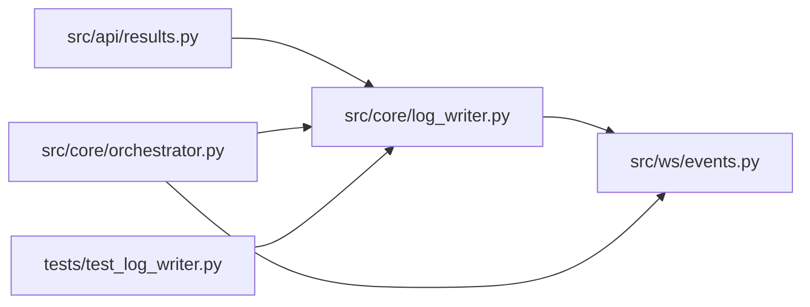

# log_writer Module

**Path:** `src/core/log_writer.py`

## Description

Persistent agent log writer — captures the full Claude conversation to JSONL.

## Imports

| Source | Symbols |
|--------|---------|
| `__future__` | `annotations` |
| `asyncio` | `asyncio` |
| `datetime` | `datetime`, `timezone` |
| `json` | `json` |
| `logging` | `logging` |
| `os` | `os` |
| `pathlib` | `Path` |
| `src.ws.events` | `broadcaster` |
| `typing` | `Any`, `Dict`, `List`, `Optional` |

## Local dependency map

<!-- Auto-generated local dependency summary. Do not edit by hand. -->

### Internal neighbors

| Direction | Module |
|---|---|
| Inbound | [results](../modules/results.md) |
| Inbound | [orchestrator](../modules/orchestrator.md) |
| Inbound | [test_log_writer](../modules/test_log_writer.md) |
| Outbound | [events](../modules/events.md) |

## Classes

| Class | Line | Bases | Description |
|-------|------|-------|-------------|
| [AgentLogWriter](../entities/AgentLogWriter.md) | 31 | — | Append-only JSONL log writer with WebSocket broadcasting. |

## Functions

| Function | Signature | Decorators | Description |
|----------|-----------|------------|-------------|
| `_format_entry` | `(entry: Dict[str, Any]) -> str` | — | Format a single log entry as a human-readable line. |
