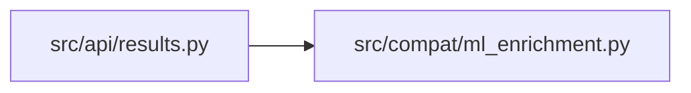

# ml_enrichment Module

**Path:** `src/compat/ml_enrichment.py`

## Description

Legacy ML enrichment helpers (moved to src/compat — P1-2).

Historical trading-skill metric projection: RL economic-replay summaries and
feature-readiness metrics for pre-migration DB rows. Nothing here may grow
new features; the domain-neutral runtime never calls these for new skills.
Kept verbatim from ``src/api/results.py`` so old sessions still render.

## Imports

| Source | Symbols |
|--------|---------|
| `__future__` | `annotations` |
| `typing` | `Any`, `Dict`, `Optional` |

## Local dependency map

<!-- Auto-generated local dependency summary. Do not edit by hand. -->

### Internal neighbors

| Direction | Module |
|---|---|
| Inbound | [results](../modules/results.md) |

## Functions

| Function | Signature | Decorators | Description |
|----------|-----------|------------|-------------|
| `_first_number` | `(*values: Any) -> Optional[float]` | — | — |
| `_rl_economic_replay` | `(metrics: Dict[str, Any]) -> Dict[str, Any]` | — | — |
| `_rl_economic_replay_summary` | `(metrics: Dict[str, Any], attempt_snapshot: Dict[str, Any]) -> Optional[Dict[str, Any]]` | — | — |
| `_feature_readiness_metrics` | `(metrics: Dict[str, Any]) -> Dict[str, Any]` | — | — |
