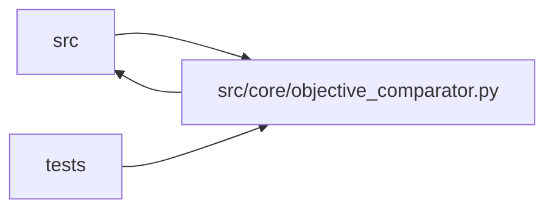

# objective_comparator Module

**Path:** `src/core/objective_comparator.py`

## Description

One objective comparator for every winner-selection path.

Before this module, each path kept its own ``primary_metric > best`` rule, so a
minimization objective (latency, loss, cost) selected the *worst* winner in the
keep/discard decision, both stores' best updates, and the displayed rankings.
Every path that answers "is this result better than that one?" now resolves a
single :class:`ObjectiveComparator` and compares through it.

Semantics (resolved once, honored everywhere):

* ``direction`` — ``minimize`` / ``maximize``, from the resolved objective
  policy (the skill's ``metric_schema.primary.direction`` vocabulary maps via
  ``objective_policy_from_skill_metric`` — the single place that knows both).
* ``epsilon`` — the *declared* tolerance: a policy's ``tie_tolerance`` wins
  when declared (> 0), else the caller's operational epsilon, else exact
  comparison (``0.0``) when nothing is declared.
* **Ties preserve the existing eligible winner.** A result beats the incumbent
  only by *more than* ``epsilon``; within ``epsilon`` the incumbent — the
  earlier, already selected result — is kept.
* **Absent/nonfinite metrics never win.** ``None``/NaN/±inf are
  ``incomparable``: they cannot beat anything and cannot become best.
* **Gate eligibility is the promotable frontier.** A row is eligible for best
  selection only with passing training gates and a present, finite metric.

Historical rows: :func:`reconcile_historical_best` re-derives a session's best
under its *known* objective and flags, never guesses, ambiguous legacy rows.

## Imports

| Source | Symbols |
|--------|---------|
| `__future__` | `annotations` |
| `dataclasses` | `dataclass` |
| `functools` | `cmp_to_key` |
| `math` | `math` |
| `src.core.execution_contracts` | `ObjectiveDirection`, `objective_policy_from_skill_metric` |
| `src.core.legacy_alias` | `model_type_to_skill_id` |
| `src.core.skill_registry` | `default_registry` |
| `typing` | `Any`, `Callable`, `Iterable`, `List`, `Literal`, `Mapping`, `Optional`, `Sequence` |

## Local dependency map

<!-- Auto-generated local dependency summary. Do not edit by hand. -->

> Module-level dependencies exceed the generated-diagram limits, so the diagram and table below group them by top-level package. Counts report the number of module neighbors in each package.

### Internal neighbors

| Direction | Module |
|---|---|
| Inbound | `src` (10) |
| Inbound | `tests` (4) |
| Outbound | `src` (3) |

> All 17 module neighbor(s) are summarized by package because the module-level view exceeds the 12-node limit.

## Classes

| Class | Kind | Line | Bases / Target | Description |
|-------|------|------|----------------|-------------|
| [Comparison](../entities/Comparison.md) | Type alias | 37 | `Literal['better', 'tie', 'worse', 'incomparable']` | — |
| [ObjectiveContextError](../entities/ObjectiveContextError.md) | Class | 52 | `ValueError` | Raised when a comparison needs objective context that is not declared. |
| [ObjectiveComparator](../entities/ObjectiveComparator.md) | Class | 65 | — | The one rule for "is this result better than that one?". |

## Functions

| Function | Signature | Decorators | Description |
|----------|-----------|------------|-------------|
| `_finite` | `(value: Any) -> Optional[float]` | — | The value as a finite float, or None when absent/nonfinite/non-numeric. |
| `select_best_row` | `(rows: Iterable[Mapping[str, Any]], comparator: ObjectiveComparator, *, value: Optional[Callable[[Mapping[str, Any]], Any]] = None, eligible: Optional[Callable[[Mapping[str, Any]], bool]] = None) -> Optional[Mapping[str, Any]]` | — | The best row under ``comparator``, or None. |
| `rank_rows` | `(rows: Iterable[Mapping[str, Any]], comparator: ObjectiveComparator, *, value: Optional[Callable[[Mapping[str, Any]], Any]] = None, eligible: Optional[Callable[[Mapping[str, Any]], bool]] = None) -> List[Mapping[str, Any]]` | — | Stable best-first ranking; ties keep input order, incomparable last. |
| `objective_comparator_for_manifest` | `(manifest: Any, *, epsilon: Optional[float] = None, metric_field: str = 'primary_metric') -> ObjectiveComparator` | — | The comparator a skill manifest declares. |
| `objective_comparator_for_skill_id` | `(skill_id: Optional[str], *, epsilon: Optional[float] = None, default: Optional[ObjectiveComparator] = None) -> ObjectiveComparator` | — | The comparator for a session's skill id (legacy ``model_type`` alias ok). |
| `reconcile_historical_best` | `(*, session: Mapping[str, Any], iterations: Sequence[Mapping[str, Any]], comparator: Optional[ObjectiveComparator] = None) -> Mapping[str, Any]` | — | Reconcile a session's stored best rows under their known objective. |
