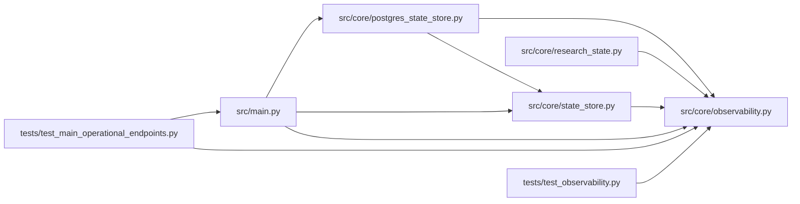

# observability Module

**Path:** `src/core/observability.py`

## Description

Production observability helpers for autoresearch operations.

## Imports

| Source | Symbols |
|--------|---------|
| `__future__` | `annotations` |
| `datetime` | `datetime`, `timezone` |
| `json` | `json` |
| `logging` | `logging` |
| `prometheus_client` | `CONTENT_TYPE_LATEST`, `REGISTRY`, `CollectorRegistry`, `generate_latest` |
| `prometheus_client.core` | `CounterMetricFamily`, `GaugeMetricFamily`, `SummaryMetricFamily` |
| `typing` | `Any`, `Iterable`, `Mapping`, `cast` |

## Local dependency map

<!-- Auto-generated local dependency summary. Do not edit by hand. -->

### Internal neighbors

| Direction | Module |
|---|---|
| Inbound | [postgres_state_store](../modules/postgres_state_store.md) |
| Inbound | [research_state](../modules/research_state.md) |
| Inbound | [state_store](../modules/state_store.md) |
| Inbound | [src_main](../modules/src_main.md) |
| Inbound | [test_main_operational_endpoints](../modules/test_main_operational_endpoints.md) |
| Inbound | [test_observability](../modules/test_observability.md) |

### External packages

| Language | Used packages | Undeclared packages |
|---|---:|---:|
| python | 1 | 0 |

## Classes

| Class | Line | Bases | Description |
|-------|------|-------|-------------|
| [_SnapshotCollector](../entities/SnapshotCollector.md) | 138 | — | — |

## Functions

| Function | Signature | Decorators | Description |
|----------|-----------|------------|-------------|
| `empty_observability_snapshot` | `(*, active_sessions: int = 0) -> dict[str, Any]` | — | Return a valid empty snapshot while the store is still starting. |
| `alert_suggestions` | `() -> list[dict[str, Any]]` | — | Return Prometheus alert suggestions for production research operations. |
| `format_prometheus` | `(snapshot: Mapping[str, Any]) -> str` | — | Render a snapshot with prometheus-client's standard exposition writer. |
| `generate_prometheus_latest` | `(snapshot: Mapping[str, Any]) -> bytes` | — | Return default process metrics plus autoresearch snapshot metrics. |
| `log_research_event` | `(logger: logging.Logger, event: str, *, level: int = logging.INFO, **context: Any) -> None` | — | Emit a structured JSON log with common research trace fields. |
| `_snapshot_registry` | `(snapshot: Mapping[str, Any]) -> CollectorRegistry` | — | — |
| `_gauge_metric` | `(name: str, help_text: str, label_names: list[str], samples: Iterable[tuple[list[str], Any]]) -> GaugeMetricFamily` | — | — |
| `_count_family` | `(name: str, help_text: str, rows: Any, label_names: tuple[str, ...], *, metric_type: str = 'gauge') -> GaugeMetricFamily \| CounterMetricFamily` | — | — |
| `_add_count_samples` | `(metric: CounterMetricFamily \| GaugeMetricFamily, rows: Any, label_names: tuple[str, ...]) -> None` | — | — |
| `_training_duration_family` | `(snapshot: Mapping[str, Any]) -> SummaryMetricFamily` | — | — |
| `_cost_families` | `(snapshot: Mapping[str, Any]) -> Iterable[CounterMetricFamily \| GaugeMetricFamily]` | — | — |
| `_iter_rows` | `(rows: Any) -> Iterable[Mapping[str, Any]]` | — | — |
| `_as_float` | `(value: Any) -> float` | — | — |
| `_as_int` | `(value: Any) -> int` | — | — |
| `_json` | `(payload: Mapping[str, Any]) -> str` | — | — |
