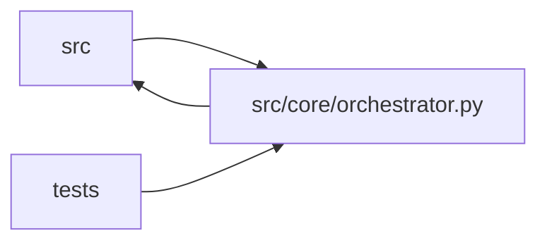

# orchestrator Module

**Path:** `src/core/orchestrator.py`

## Description

Agent orchestrator — drives Claude via the Anthropic SDK with tool use.

## Imports

| Source | Symbols |
|--------|---------|
| `__future__` | `annotations` |
| `asyncio` | `asyncio` |
| `dataclasses` | `dataclass`, `field` |
| `datetime` | `datetime`, `timezone` |
| `glob` | `glob_mod` |
| `json` | `json` |
| `logging` | `logging` |
| `math` | `math` |
| `os` | `os` |
| `pathlib` | `Path` |
| `re` | `re` |
| `shlex` | `shlex` |
| `src.config` | `secret_value`, `settings` |
| `src.core` | `fs_safety` |
| `src.core.agent_tools` | `AGENT_TOOLS`, `ToolAccessContext`, `ToolExecutionResult`, `_config_snapshot_path_from_command`, `_execute_tool`, `_load_packaged_skill_md`, `_nonce_env_for_command`, `_normalize_command_for_plan`, `_tool_bash`, `_tool_glob`, `_tool_grep`, `_tool_read_file`, `_tool_write_file`, `build_tool_access_context` |
| `src.core.artifact_reference` | `normalize_artifact_references_in_mapping` |
| `src.core.command_runner` | `CommandProcessRegistry`, `GovernedCommandRunner`, `OutputCallback`, `_build_child_env`, `redact_sensitive_text` |
| `src.core.consistency_validator` | `ACCEPTED_ADAPTIVE_NOOP_REASONS`, `build_consistency_report`, `check_adaptive_feature_sweep`, `consistency_report_json` |
| `src.core.experiment_parser` | `parse_iteration_marker`, `parse_prepare_output` |
| `src.core.gate_status` | `normalize_training_gate_aliases`, `training_gates_passed_from_iteration` |
| `src.core.iteration_context` | `ITERATION_CONTEXT_DIGEST_MARKER`, `build_iteration_context_digest`, `derive_exploration_markers` |
| `src.core.iteration_snapshot` | `build_iteration_attempt_snapshot`, `build_trial_identity`, `canonical_config_hash`, `trial_identity_hash`, `write_iteration_attempt_snapshot` |
| `src.core.llm_provider` | `_CLAUDE_INPUT_USD_PER_TOKEN`, `_CLAUDE_MAX_OUTPUT_TOKENS`, `_CLAUDE_OUTPUT_USD_PER_TOKEN`, `AnthropicProvider`, `ContentBlock`, `LLMProvider`, `Message`, `MockProvider`, `ProviderCapabilityMismatch`, `ProviderResponse`, `RequestBlock`, `RequiredCapabilities`, `StopReason`, `TextBlock`, `ToolDef`, `ToolResultBlock`, `ToolUseBlock`, `Usage`, `build_provider` |
| `src.core.log_writer` | `AgentLogWriter` |
| `src.core.output_digest` | `digest_command_output` |
| `src.core.output_parser` | `DelimitedKVParser`, `JSONMarkerParser`, `OutputParser` |
| `src.core.research_phase_plan` | `_PHASE_ADVANCEMENT_KEYS`, `EVIDENCE_INHERITABLE_PHASES`, `NOOP_INHERITABLE_PHASES`, `_is_rejected_duplicate`, `build_phase_state`, `incomplete_phase_ids`, `phase_cap_exceeded`, `phase_state_json` |
| `src.core.result_artifact` | `enrich_marker_from_result_artifact` |
| `src.core.significance` | `REGRESSION`, `SIGNIFICANT`, `best_config_hash`, `samples_from_rows`, `significance_verdict` |
| `src.core.skill_runtime` | `SkillConfigError`, `SkillRuntime`, `materialize_skill_runtime` |
| `src.core.state_machine` | `IllegalTransitionError`, `SessionEvent`, `SessionState`, `SessionStateMachine` |
| `src.core.state_store` | `StateStore` |
| `src.core.trial_workspace` | `TrialContext`, `build_trial_context`, `is_trial_eligible_command`, `trial_marker_candidates` |
| `src.ws.events` | `broadcaster` |
| `subprocess` | `subprocess` |
| `time` | `time` |
| `typing` | `Any`, `AsyncGenerator`, `Dict`, `Iterable`, `List`, `Mapping`, `Optional` |
| `yaml` | `yaml` |

## Local dependency map

<!-- Auto-generated local dependency summary. Do not edit by hand. -->

> Module-level dependencies exceed the generated-diagram limits, so the diagram and table below group them by top-level package. Counts report the number of module neighbors in each package.

### Internal neighbors

| Direction | Module |
|---|---|
| Inbound | `src` (2) |
| Inbound | `tests` (36) |
| Outbound | `src` (22) |

### External packages

| Language | Used packages | Undeclared packages |
|---|---:|---:|
| python | 1 | 0 |

> All 59 module neighbor(s) are summarized by package because the module-level view exceeds the 12-node limit.

## Classes

| Class | Line | Bases | Description |
|-------|------|-------|-------------|
| [ResearchConfig](../entities/ResearchConfig.md) | 188 | — | — |
| [TurnTrialState](../entities/TurnTrialState.md) | 272 | — | Mutable per-turn execution state owned by the agent tool loop. |
| [PendingTrial](../entities/PendingTrial.md) | 302 | — | One deferred trial execution (P2 parallel-trial dispatch). |
| [AgentOrchestrator](../entities/AgentOrchestrator.md) | 327 | — | Runs a Claude agent session for autonomous ML experiment tuning. |
