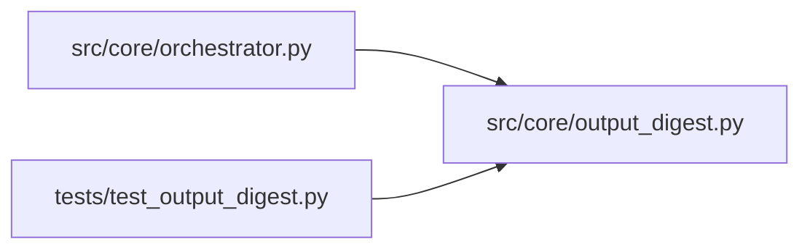

# output_digest Module

**Path:** `src/core/output_digest.py`

## Description

Track D2: digest bash tool output before it enters the agent's context.

The bash tool previously returned the FULL combined stdout+stderr of every
command into the conversation (read_file caps at 100k, grep at 60k — bash had
no cap at all). A full-mode training run streams 50–200KB of per-fold logs,
progress ticks and library INFO spam, which then gets re-read as input tokens
on EVERY subsequent turn of the session.

The digest keeps everything the agent acts on — the ``---`` metrics block,
``ITERATION_RESULT`` markers, errors/tracebacks/warnings, per-fold gate lines,
head and tail context — collapses recognizable noise into counted one-liners,
and points at the on-disk full log (readable via the read_file/grep tools)
for anything else.

The SERVER always parses markers from the RAW output — digesting only changes
what the LLM sees, never what the orchestrator records.

## Imports

| Source | Symbols |
|--------|---------|
| `__future__` | `annotations` |
| `re` | `re` |
| `typing` | `List`, `Optional`, `Tuple` |

## Local dependency map

<!-- Auto-generated local dependency summary. Do not edit by hand. -->

### Internal neighbors

| Direction | Module |
|---|---|
| Inbound | [orchestrator](../modules/orchestrator.md) |
| Inbound | [test_output_digest](../modules/test_output_digest.md) |

## Functions

| Function | Signature | Decorators | Description |
|----------|-----------|------------|-------------|
| `_last_metrics_block` | `(text: str) -> Optional[str]` | — | The last ``---`` … ``---`` delimited block (prepare.py metrics). |
| `digest_command_output` | `(output: str, *, max_chars: int = DEFAULT_MAX_CHARS, full_log_path: Optional[str] = None) -> str` | — | Return a context-friendly digest of a command's combined output. |
